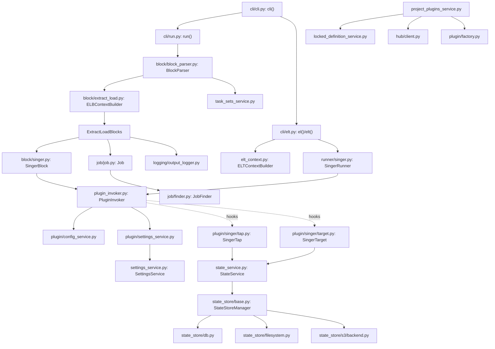

> Bagian 2 dari 16 - [Daftar Isi](README.md)

## 2. Peta Modul dan Dependensi

### 2.1 Struktur tingkat atas

| Path | Peran |
|---|---|
| `pyproject.toml` | Metadata paket, dependency, entry point CLI & plugin add-on |
| `src/meltano/cli/` | Lapisan Click: parsing argumen, I/O terminal, exit code |
| `src/meltano/core/` | Seluruh domain logic: project, plugin, block, state, job, logging |
| `src/meltano/migrations/` | Migrasi Alembic untuk system database |
| `src/meltano/schemas/` | JSON Schema untuk `meltano.yml` |
| `tests/` | Unit test; `tests/meltano/cli/` berisi integration test workflow CLI penuh |
| `docs/` | Dokumentasi VuePress |

### 2.2 Entry point

```toml
# pyproject.toml:93-94
[project.scripts]
meltano = "meltano.cli:main"
```

- `src/meltano/cli/__main__.py:3-5` -> `main()` untuk `python -m meltano`.
- `src/meltano/cli/__init__.py:141-168` -> `main()`: set `MELTANO_JOB_TRIGGER=cli`, jalankan `_run_cli()`,
  di `finally` menghitung `exit_code` dan mengirim exit event telemetry.
- `src/meltano/cli/__init__.py:107-138` -> `_run_cli()`: menangkap `ProjectReadonly`, `KeyboardInterrupt`,
  `asyncio.CancelledError` (memetakan SIGTERM ke `SIGTERM_EXIT_CODE`), `MeltanoError` -> `CliError`.
- `src/meltano/cli/__init__.py:51-75` -> registrasi 25+ subcommand ke grup `cli`.

Grup Click: `src/meltano/cli/cli.py:55-64`
`@click.group(cls=NoWindowsGlobbingGroup, invoke_without_command=True, ...)`.
Fungsi `cli` (`src/meltano/cli/cli.py:98-181`) melakukan `ProjectSettingsService.config_override` untuk log
level, `setup_logging()`, lalu `Project.find(dotenv_file=env_file)`, dan mengisi
`ctx.obj["project"]`/`ctx.obj["tracker"]`. Helper `detect_selected_environment` ada di
`src/meltano/cli/cli.py:184`.

### 2.3 Teknologi & library inti

Dari `pyproject.toml:30-61`:

| Library | Fungsi di Meltano |
|---|---|
| `click` >=8.3,<8.6 + `click-default-group` | Framework CLI |
| `sqlalchemy` >=2.0 | Model `Job`, `JobState`, engine system database |
| `alembic` | Migrasi system db |
| `structlog` >=25.5 | Structured logging seluruh aplikasi |
| `anyio` | Digunakan di `plugin/singer/base.py` |
| `jsonschema` + `ruamel.yaml` | Validasi `meltano.yml` & schema plugin |
| `python-dotenv` | `.env` project |
| `uv` + `virtualenv` + `pip` | Isolasi environment per-plugin |
| `smart-open`, `boto3`, `azure-storage-blob`, `google-cloud-storage` | Backend state object storage |
| `snowplow-tracker` | Telemetri |
| `psutil` | Utilitas proses |
| `fasteners` | Inter-process lock project |
| `aiodocker` | Plugin containerized |

Optional deps penting: `postgres` -> `psycopg`, `mssql` -> `pymssql`, `s3`/`gcs`/`azure` untuk state backend.

### 2.4 Entry points plugin (arsitektur add-on)

```toml
# pyproject.toml:109-116
[project.entry-points."meltano.state_backends"]
azure = "meltano.core.state_store.azure.backend:AZStorageStateStoreManager"
file  = "meltano.core.state_store.filesystem:LocalFilesystemStateStoreManager"
gs    = "meltano.core.state_store.google.backend:GCSStateStoreManager"
s3    = "meltano.core.state_store.s3.backend:S3StateStoreManager"
```

Ini adalah mekanisme ekstensi resmi Meltano: backend tambahan di-load lewat `importlib.metadata.entry_points`
(`src/meltano/core/state_store/__init__.py:29-32`, kelas `StateBackend`, `MeltanoAddon`).

### 2.5 Grafik dependensi modul (hasil pembacaan import aktual)



---

**Navigasi:** [Bagian 1](01-ringkasan-eksekutif.md) - [Daftar Isi](README.md) - [Bagian 3](03-alur-eksekusi-pipeline.md)
