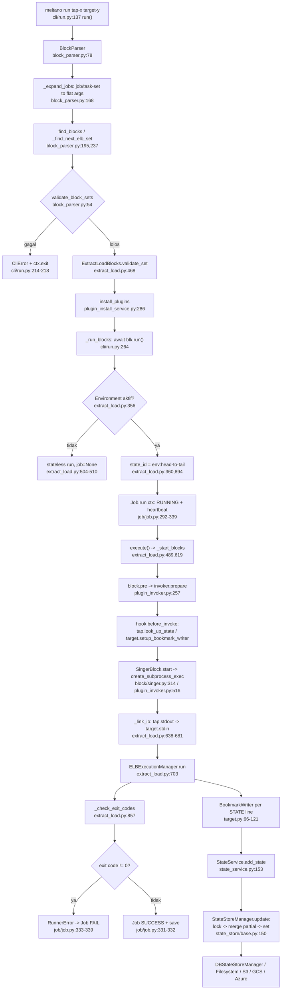
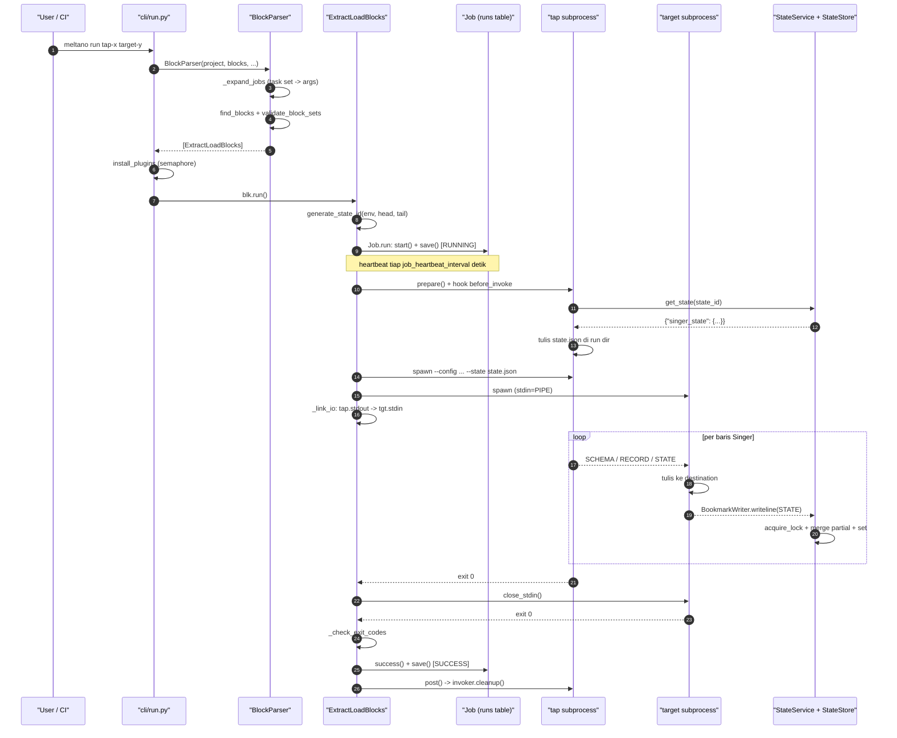

> Bagian 7 dari 16 - [Daftar Isi](README.md)

## 7. Diagram Arsitektur dan Sequence

### 7.1 Flowchart eksekusi aktual (`meltano run`)

Diagram ini sengaja menyimpang dari asumsi umum: **state ditulis di dalam loop eksekusi (setiap STATE),
bukan sebagai tahap terpisah setelah pemuatan selesai.** Penyelesaian job (`SUCCESS`) dan penyimpanan state
adalah dua jalur paralel yang tidak transaksional.

### 7.2 Sequence diagram

### 7.3 Relasi antarmodul kunci (ringkas)

| Dari | Ke | Melalui |
|---|---|---|
| `cli/run.py` | `block/block_parser.py` | `BlockParser`, `validate_block_sets` |
| `block/block_parser.py` | `block/extract_load.py` | `ELBContextBuilder`, `ExtractLoadBlocks` |
| `block/extract_load.py` | `block/singer.py` | `SingerBlock` di `make_block` |
| `block/singer.py` | `plugin_invoker.py` | `invoke_async`, `StdioSource` |
| `plugin_invoker.py` | `plugin/singer/{tap,target}.py` | hooks `before_invoke` |
| `plugin/singer/target.py` | `state_service.py` | `BookmarkWriter` -> `add_state` |
| `state_service.py` | `state_store/` | `state_store_manager_from_project_settings` |
| `plugin/singer/tap.py` | `state_service.py` | `get_singer_state` |
| `block/extract_load.py` | `job/job.py` | `Job.run` ctx manager |
| `cli/elt.py` | `runner/singer.py` | `SingerRunner` (jalur legacy) |

---

**Navigasi:** [Bagian 6](06-subprocess-dan-reliability.md) - [Daftar Isi](README.md) - [Bagian 8](08-pemetaan-ke-golang.md)
