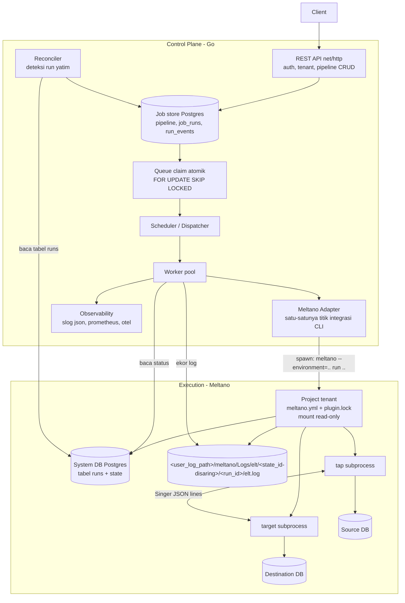
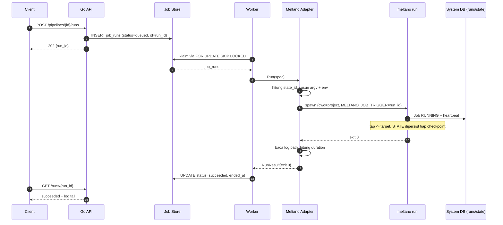
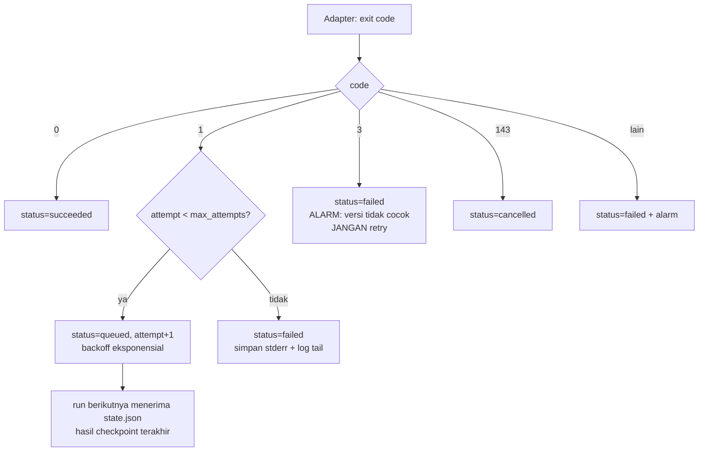
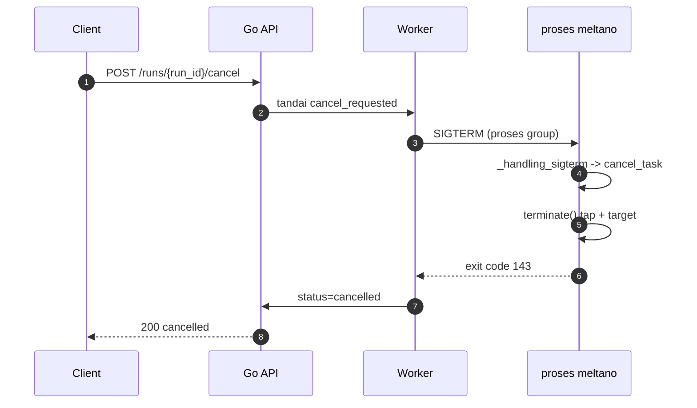

> Bagian 13 dari 16 - [Daftar Isi](README.md)

# 13. Arsitektur Control Plane & Kontrak Integrasi Meltano

Bagian ini adalah **rancangan**, bukan deskripsi perilaku Meltano. Aturannya: fakta tentang Meltano selalu
disertai path dan baris (`src/...:N`), sedangkan keputusan desain ditandai sebagai rekomendasi.

Model yang dipakai: **Meltano = execution engine**, **control plane = layanan Go Anda**. Meltano tidak
memiliki control plane; ia hanya CLI (bagian 2.2). Karena itu integrasinya adalah integrasi **proses**,
bukan integrasi API.

---

## 13.1 Prinsip dan Pembagian Tanggung Jawab

**Aturan emas:** control plane hanya berbicara ke Meltano lewat empat kanal yang memang publik:

1. **argv CLI** — `meltano ...`
2. **environment variable** — untuk setting dan parameter run
3. **exit code** — hasil terminal
4. **artefak hasil** — baris tabel `runs`/`state`, file log, output `--format json`

Jangan meng-import `meltano.core.*`, jangan menambal source, jangan menulis ke `meltano.yml` saat runtime.
Alasan: Meltano menandai API internalnya sebagai tidak stabil — lihat `MeltanoInternalDeprecationWarning`
dengan docstring *"Warning for deprecated internal Meltano APIs"* (`src/meltano/core/_compat.py:17-18`) dan
modul ber-prefix `_` seperti `_state.py`, `_compat.py`, `_protocols/`.

| Tanggung jawab | Control plane (Go) | Meltano (engine) |
|---|---|---|
| Auth, tenant, kuota | ✅ | — |
| API definisi pipeline | ✅ | — |
| Antrean, lease, konkurensi | ✅ | — |
| Retry, backoff, kebijakan kegagalan | ✅ | ❌ tidak ada (bagian 6.5) |
| Pembatalan & timeout | ✅ memicu | ✅ mengeksekusi graceful stop |
| Status, log, metrics | ✅ | menyediakan bahan |
| Resolusi & instalasi plugin | memicu saat provisioning | ✅ |
| Isolasi venv | — | ✅ |
| Materialisasi config + env | menyuplai env var | ✅ |
| Plumbing Singer tap↔target | — | ✅ |
| Persistensi state | membaca/mengawasi | ✅ |
| Korelasi run ID | ✅ | ✅ lewat `--run-id` + `MELTANO_JOB_TRIGGER` |

---

## 13.2 Arsitektur Keseluruhan



Yang perlu diperhatikan dari diagram ini: **tidak ada panah dari control plane ke dalam proses Meltano
selain spawn dan sinyal.** Tidak ada callback, tidak ada event stream. Semua observasi bersifat *pull*
(baca DB/log) — konsekuensi langsung dari tidak adanya server mode di Meltano.

---

## 13.3 Komponen Control Plane

| # | Komponen | Tanggung jawab | Interface Go | Padanan Meltano |
|---|---|---|---|---|
| 1 | **API** | Terima request, auth, validasi, CRUD pipeline, status | `net/http` + router; `internal/api` | — (Meltano hanya CLI) |
| 2 | **Job Store** | Persistensi pipeline, run, event | `pgx` + `sqlc`; `internal/store` | tabel `runs` + `state` (`job/job.py:128`, `job_state.py:36`) |
| 3 | **Queue** | Klaim job atomik, lease, requeue | `FOR UPDATE SKIP LOCKED`; `internal/queue` | *tidak ada padanan* — `JobFinder.latest_running` hanya query advisory (`block/extract_load.py:530`) |
| 4 | **Scheduler** | Poll queue, prioritas, konkurensi, cron | `internal/scheduler` | `ScheduleService` tanpa daemon (`schedule_service.py:253`) |
| 5 | **Worker** | Jalankan satu job, heartbeat lease | `internal/worker` | proses `meltano run` |
| 6 | **Meltano Adapter** | Bangun argv+env, spawn, tangkap exit code, hitung path | `internal/meltano` | `MeltanoInvoker` (`meltano_invoker.py:35`) sebagai pola, tapi milik Anda |
| 7 | **Status Reader** | Baca riwayat/status run | `internal/meltano` | `meltano logs list --format json` (`cli/logs.py:106`) |
| 8 | **State Reader** | Baca state Singer sebuah `state_id` | `internal/meltano` | `meltano state get` (`cli/state.py:342`) atau tabel `state` |
| 9 | **Log Tailer** | Streaming log per run | `internal/observability` | file `elt.log` (`job_logging_service.py:57-73`) |
| 10 | **Reconciler** | Deteksi worker mati, kill proses yatim, requeue | `internal/worker` | ✅ Meltano menandai *baris* stale, **tidak** mematikan proses (`stale_job_failer.py:25-29`) |
| 11 | **Observability** | slog JSON, metrics, trace | `log/slog`, `prometheus`, `otel` | structured logging + `run_id` contextvar (`logging/output_logger.py:282`) |

Komponen 6 adalah inti jawaban "cara control plane hit Meltano". Ia harus menjadi **satu-satunya** tempat di
seluruh codebase yang mengetahui detail CLI Meltano — sehingga perubahan upstream hanya menyentuh satu paket.

### Sketsa interface adapter

```go
package meltano

// Adapter adalah satu-satunya titik integrasi ke CLI Meltano.
type Adapter interface {
    // Run mengeksekusi satu pipeline sampai selesai dan mengembalikan hasil terminal.
    Run(ctx context.Context, spec RunSpec) (RunResult, error)
    // Status membaca riwayat run dari Meltano (baca tabel `runs` atau `logs list --format json`).
    Status(ctx context.Context, projectDir string, limit int) ([]MeltanoRun, error)
    // State membaca state Singer untuk sebuah state_id.
    State(ctx context.Context, projectDir string, stateID string) (map[string]any, error)
}

type RunSpec struct {
    ProjectDir     string            // cwd proses; direktori project tenant (read-only)
    Environment    string            // -> --environment=<env>
    Extractor      string            // -> argumen posisional 1
    Loader         string            // -> argumen posisional 2
    StateIDSuffix  string            // -> --state-id-suffix=<suffix>   (opsional)
    RunID          uuid.UUID         // -> --run-id=<uuid>  (dan MELTANO_JOB_TRIGGER)
    Timeout        time.Duration     // -> --timeout=<detik>
    FullRefresh    bool              // -> --full-refresh
    RefreshCatalog bool              // -> --refresh-catalog
    ExtraEnv       map[string]string // kredensial konektor, TIDAK ditulis ke meltano.yml
}

type RunResult struct {
    ExitCode  int
    StateID   string // dihitung control plane, lihat 13.5.4
    LogPath   string // <user_log_path>/meltano/Logs/elt/<state_id-disaring>/<run_id>/elt.log
    Duration  time.Duration
    TimedOut  bool
    Cancelled bool
}
```

---

## 13.4 Model Data Control Plane

Skema ini **milik Anda** dan tidak bergantung pada skema internal Meltano — kecuali kolom yang sengaja
dikorelasikan (`meltano_state_id`, `meltano_trigger`).

```sql
-- Satu tenant = satu direktori project Meltano (meltano.yml + plugin.lock), di-mount read-only.
CREATE TABLE tenants (
  id           uuid PRIMARY KEY,
  name         text NOT NULL UNIQUE,
  project_dir  text NOT NULL,          -- path project Meltano tenant ini
  created_at   timestamptz NOT NULL DEFAULT now()
);

-- Definisi pipeline = pemetaan ke (environment, extractor, loader).
CREATE TABLE pipelines (
  id               uuid PRIMARY KEY,
  tenant_id        uuid NOT NULL REFERENCES tenants(id),
  name             text NOT NULL,
  environment      text NOT NULL,
  extractor        text NOT NULL,      -- harus cocok dengan nama plugin di meltano.yml
  loader           text NOT NULL,
  state_id_suffix  text,               -- opsional; TIDAK boleh mengandung ':'
  default_timeout_s integer NOT NULL DEFAULT 3600,
  max_attempts     integer NOT NULL DEFAULT 3,
  enabled          boolean NOT NULL DEFAULT true,
  UNIQUE (tenant_id, name)
);

CREATE TABLE job_runs (
  id               uuid PRIMARY KEY,   -- dipakai sebagai --run-id
  pipeline_id      uuid NOT NULL REFERENCES pipelines(id),
  status           text NOT NULL,      -- queued|running|succeeded|failed|cancelled|timed_out
  attempt          integer NOT NULL DEFAULT 1,
  -- kolom korelasi ke Meltano:
  meltano_state_id text,               -- hasil generate_state_id, lihat 13.5.4
  meltano_trigger  text NOT NULL,      -- = id::text, dikirim via MELTANO_JOB_TRIGGER
  -- lifecycle:
  claimed_by       text,
  lease_expires_at timestamptz,
  exit_code        integer,
  error            text,
  created_at       timestamptz NOT NULL DEFAULT now(),
  started_at       timestamptz,
  ended_at         timestamptz
);
CREATE INDEX ix_job_runs_claim ON job_runs (status, created_at) WHERE status = 'queued';
CREATE INDEX ix_job_runs_pipeline ON job_runs (pipeline_id, created_at DESC);

CREATE TABLE run_events (
  id         bigserial PRIMARY KEY,
  run_id     uuid NOT NULL REFERENCES job_runs(id),
  at         timestamptz NOT NULL DEFAULT now(),
  kind       text NOT NULL,            -- log_line|state_checkpoint|phase|error
  payload    jsonb NOT NULL
);
```

Klaim job atomik tanpa broker eksternal:

```sql
UPDATE job_runs
   SET status = 'running',
       claimed_by = $1,
       lease_expires_at = now() + interval '5 minutes',
       started_at = now()
 WHERE id = (
   SELECT id FROM job_runs
    WHERE status = 'queued'
    ORDER BY created_at
    FOR UPDATE SKIP LOCKED
    LIMIT 1
 )
RETURNING *;
```

Catatan: Meltano **tidak punya** mekanisme ini. Yang ada hanya `JobFinder.latest_running` sebagai
pengecekan advisory (`src/meltano/core/block/extract_load.py:527-538`), yang tidak melindungi dari dua
request bersamaan. Karena itu jangan pernah mengandalkan `--force` dari API; gunakan antrean Anda sendiri.

---

## 13.5 Kontrak Integrasi

### 13.5.1 Environment variable

Parameter run **bisa** dikirim lewat env var, bukan hanya argv. Semua nama di bawah ini terverifikasi dari
deklarasi `click.option(..., envvar=...)`:

| Env var | Memetakan ke | Bukti |
|---|---|---|
| `MELTANO_RUN_FULL_REFRESH` | `--full-refresh` | `cli/run.py:63` |
| `MELTANO_RUN_REFRESH_CATALOG` | `--refresh-catalog` | `cli/run.py:70` |
| `MELTANO_RUN_NO_STATE_UPDATE` | `--no-state-update` | `cli/run.py:77` |
| `MELTANO_RUN_FORCE` | `--force` | `cli/run.py:87` |
| `MELTANO_RUN_STATE_ID_SUFFIX` | `--state-id-suffix` | `cli/run.py:93` |
| `MELTANO_RUN_STATE_STRATEGY` | `--state-strategy` | `cli/run.py:107` |
| `MELTANO_RUN_ID` | `--run-id` | `cli/run.py:114` |
| `MELTANO_RUN_TIMEOUT` | `--timeout` | `cli/run.py:121` |
| `MELTANO_STATE_ID` | `--state-id` | `cli/elt.py:108` (hanya jalur `el`/`elt`) |
| `MELTANO_PROJECT_READONLY` | `project_readonly` | `core/project.py:60,287` |
| **`MELTANO_JOB_TRIGGER`** | kolom `runs.trigger` | `cli/__init__.py:147`, `job/job.py:103-109,144` |

Setting project juga bisa di-set lewat env var. Konvensinya: prefix `meltano` (`settings_service.py:130`)
digabung nama setting, non-alfanumerik menjadi `_`, lalu di-uppercase (`utils/__init__.py:393-410`):

| Env var | Setting | Bukti |
|---|---|---|
| `MELTANO_DATABASE_URI` | `database_uri` | `bundle/settings.yml:18-21` |
| `MELTANO_STATE_BACKEND_URI` | `state_backend.uri` | `bundle/settings.yml:58-61` |
| `MELTANO_AUTO_INSTALL` | `auto_install` | `bundle/settings.yml:52-55`, `cli/params.py:42-51` |
| `MELTANO_JOB_HEARTBEAT_INTERVAL` | `job_heartbeat_interval` | `bundle/settings.yml:30-33` |
| `MELTANO_ELT_BUFFER_SIZE` | `elt.buffer_size` | `bundle/settings.yml:46-49` |
| `MELTANO_SEND_ANONYMOUS_USAGE_STATS` | `send_anonymous_usage_stats` | `bundle/settings.yml:7-10` |
| `MELTANO_CLI_LOG_FORMAT` | `cli.log_format` | dipakai di `cli/cli.py:123` |

**`MELTANO_JOB_TRIGGER` adalah mekanisme korelasi terbaik yang tersedia.** Meltano hanya mengisinya dengan
`"cli"` bila belum diset (`cli/__init__.py:147`), nilai itu disimpan ke kolom `runs.trigger`
(`job/job.py:103-109,144`), dan kolom tersebut **ikut keluar** di output JSON:

```json
{"runs": [{"log_id": "...", "job_name": "prod:tap-x-to-target-y",
           "state": "SUCCESS", "started_at": "...", "ended_at": "...",
           "duration_seconds": 42.1, "trigger": "<id-run-anda>"}], "total": 1}
```

### 13.5.2 Command line

Template pemanggilan yang direkomendasikan:

```
meltano
  --environment=<environment>
  --cwd=<project_dir>            # opsional; alternatif: set cwd proses
  --log-format=json
  run
  <extractor>
  <loader>
  --state-id-suffix=<suffix>     # opsional, lihat 13.5.4
  --run-id=<uuid>
  --timeout=<detik>
  --no-install
```

Catatan penting dari implementasi:

- **Opsi tingkat grup harus mendahului subcommand.** `--environment`, `--cwd`, `--env-file`, `--log-level`,
  `--log-format`, `--log-config` didefinisikan pada grup `cli` (`src/meltano/cli/cli.py:65-96`), sedangkan
  `run` adalah subcommand. Jadi urutannya `meltano --environment=X run ...`, bukan sebaliknya.
- **`--timeout` hanya ada di `meltano run`** (`cli/run.py:117-126`), tidak di `el`/`elt`.
- **`--no-install` tersedia di `run`** (`cli/run.py:132`), dan wajib Anda pakai. Default `auto_install` adalah
  `true` (`bundle/settings.yml:52-55`); tanpa `--no-install`, satu request user bisa memicu pembuatan venv
  dan unduhan dependency.
- **`--log-format=json`** membuat log Meltano dapat di-parse (`logging/utils.py:100-107`).

### 13.5.3 Kontrak proses

| Aspek | Nilai | Catatan |
|---|---|---|
| Binary | `meltano` | entry point `meltano.cli:main` (`pyproject.toml:94`) |
| `cwd` | direktori project tenant | set lewat `cwd` proses atau `--cwd` (`cli/cli.py:87-91`) |
| `stdin` | tidak dipakai | tutup |
| `stdout` | log Meltano | tangkap, jangan di-parse sebagai protokol |
| `stderr` | log | idem |
| Durasi startup | proses Python: `setup_logging`, `Project.find`, tracker | `cli/cli.py:98-181` |
| Tambahan per-run | koneksi DB + `MigrationService.upgrade` | `cli/run.py:134` → `cli/params.py:159-168` |

Dua baris terakhir punya konsekuensi operasional: **setiap invokasi membuka koneksi ke system database dan
menjalankan migrasi Alembic.** Lakukan warm-up saat deploy supaya migrasi pertama tidak dipicu oleh request
user, dan hindari lonjakan job bersamaan tepat setelah upgrade versi.

### 13.5.4 Exit code

| Code | Arti | Bukti |
|---|---|---|
| `0` | sukses | `Job.run` menyelesaikan `success()` (`job/job.py:331-332`) |
| `1` | gagal (default `CliError`) | `cli/utils.py:54` |
| `1` | blok gagal / timeout | `cli/run.py:311`, `cli/run.py:249` |
| `3` | versi Meltano tidak kompatibel dengan project | `cli/cli.py:172-181` |
| `143` | proses dihentikan SIGTERM | `job/job.py:43`, `cli/__init__.py:122-127` |

Kebijakan retry yang direkomendasikan:

| Exit code | Tindakan |
|---|---|
| `0` | tandai `succeeded` |
| `1` | retry dengan backoff bila `attempt < max_attempts`; state sudah tersimpan sehingga lanjut dari bookmark |
| `3` | **jangan retry**; alarm — mismatch versi image vs project |
| `143` | tandai `cancelled` (bila Anda yang mengirim SIGTERM) atau `failed` (bila pihak lain) |
| lainnya | tandai `failed`, simpan stderr, alarm |

### 13.5.5 Identitas: `run_id`, `state_id`, dan `trigger`

Tiga identitas yang harus Anda kendalikan:

| Identitas | Anda set lewat | Meltano menyimpan di |
|---|---|---|
| `run_id` | `--run-id=<uuid>` (`cli/run.py:110-116`) | kolom `runs.run_id`; muncul sebagai `log_id` di JSON |
| `trigger` | env `MELTANO_JOB_TRIGGER` | kolom `runs.trigger`; muncul sebagai `trigger` di JSON |
| `state_id` | **tidak langsung** — lihat di bawah | kolom `runs.job_name` dan tabel `state.state_id` |

**`state_id` tidak bisa di-set bebas di `meltano run`.** Daftar opsi `run` yang terverifikasi
(`src/meltano/cli/run.py:48-130`) hanya memuat `--state-id-suffix`; tidak ada `--state-id`. Nilainya
dihitung di `generate_state_id` (`src/meltano/core/block/extract_load.py:894-931`):

```python
# extract_load.py:919-931
state_id_components = [
    project.environment.name,
    f"{consumer.string_id}-to-{producer.string_id}",   # consumer=head=extractor, producer=tail=loader
    state_id_suffix or project.environment.state_id_suffix,
]
if any(c for c in state_id_components if c and STATE_ID_COMPONENT_DELIMITER in c):
    raise RunnerError("Cannot generate a state ID from components containing the delimiter ...")
return STATE_ID_COMPONENT_DELIMITER.join(c for c in state_id_components if c)
```

Dengan `STATE_ID_COMPONENT_DELIMITER = ":"` (`src/meltano/core/constants.py:5`), format efektifnya:

```
{environment}:{extractor}-to-{loader}[:{state_id_suffix | environment.state_id_suffix}]
```

Contoh: `prod:tap-postgres-to-target-snowflake` atau
`tenant-a:tap-postgres-to-target-postgres:backfill-2026-10`.

**Rekomendasi penataan identitas:**

- **`environment` = tenant** (atau tenant+region). Ini memberi isolasi state antar tenant secara alami.
- **`state_id_suffix` = varian**, bukan identitas utama. Pakai untuk backfill, re-sync, atau generasi baru —
  bukan untuk setiap run, karena setiap suffix berbeda berarti bookmark baru.
- Validasi di sisi Go: environment, nama extractor, nama loader, dan suffix **tidak boleh mengandung `:`**,
  karena Meltano menolaknya dengan `RunnerError` (`extract_load.py:925-929`).

Control plane harus **menghitung sendiri** string `state_id` dengan formula identik, karena nilainya
dibutuhkan untuk `meltano state get <state_id>` dan untuk menyusun path log.

### 13.5.6 Membaca status dan state

Tiga jalur, dengan trade-off yang berbeda:

| Jalur | Cara | Latensi | Stabilitas | Bukti |
|---|---|---|---|---|
| **A. CLI JSON** | `meltano logs list --format json` | spawn Python per panggilan | cukup stabil (kontrak CLI) | `cli/logs.py:106-123` |
| **B. Baca tabel langsung** | `SELECT ... FROM runs` / `state` di Postgres yang sama | sangat cepat | terikat skema; ada 21 file migrasi | `job/job.py:128-153`, `job_state.py:36-42` |
| **C. Baca file log** | `<user_log_path>/meltano/Logs/elt/<state_id-disaring>/<run_id>/elt.log` | cepat, tanpa proses | di luar project; nama disaring | `project_dirs_service.py:128-140,167-188` |

Bentuk JSON jalur A (terverifikasi dari konstruksi dict di `cli/logs.py:107-123`):

```json
{
  "runs": [
    {
      "log_id": "<run_id>",
      "job_name": "<state_id>",
      "state": "SUCCESS",
      "started_at": "2026-10-16T02:11:04+00:00",
      "ended_at": "2026-10-16T02:12:31+00:00",
      "duration_seconds": 87.0,
      "trigger": "<MELTANO_JOB_TRIGGER>"
    }
  ],
  "total": 1
}
```

Nilai `state` berasal dari `Job.state.name` (`cli/logs.py:111`), yaitu salah satu dari
`IDLE|RUNNING|SUCCESS|FAIL|DEAD|STATE_EDIT` (`job/job.py:61-69`). Perhatikan bahwa `Job` berstatus
`STATE_EDIT` merepresentasikan tulisan `meltano state` CLI, bukan run pipeline — saring bila perlu
(dijelaskan di docstring `job/job.py:122-125`).

State Singer: `meltano state get <state_id>` mencetak JSON (`cli/state.py:342-351`), dengan bentuk internal
`{"singer_state": {...}}` — kunci wajib `singer_state` (`src/meltano/core/job_state.py:24`,
`src/meltano/core/state_service.py:139-151`).

**Rekomendasi:** pakai jalur **B** untuk hot path status (polling cepat) hanya bila Anda mem-pin versi
Meltano dan siap mengikuti migrasinya; jalur **A** sebagai verifikasi silang dan untuk kejadian yang jarang;
jalur **C** untuk streaming log ke pengguna.

### 13.5.7 Pembatalan dan timeout

Meltano tidak punya API pembatalan. Mekanismenya adalah sinyal OS:

1. Control plane mengirim **SIGTERM** ke proses `meltano` (proses group, agar tap/target ikut).
2. Meltano memasang handler `loop.add_signal_handler(signal.SIGTERM, cancel_task)`
   (`src/meltano/core/job/job.py:448-496`) yang membatalkan task sehingga termination mengikuti jalur
   cancellation yang sama dengan SIGINT.
3. Subprocess ditutup lewat `terminate()` (SIGTERM) atau `kill()` (SIGKILL)
   (`src/meltano/core/block/singer.py:334-349`).
4. Proses keluar dengan **143** (`job/job.py:43`).

Lapisan pertahanan berlapis yang direkomendasikan:

| Lapis | Mekanisme | Kapan |
|---|---|---|
| 1 | `--timeout=<detik>` (`cli/run.py:117-126`) | batas normal; Meltano mencatat "Run timed out" |
| 2 | SIGTERM dari control plane | pembatalan manual atau timeout yang tidak dihormati |
| 3 | SIGKILL setelah grace period (mis. 30 detik) | proses tidak merespons |
| 4 | Lease expiry + Reconciler | worker mati sehingga tidak ada yang mengirim sinyal |

Berbeda dengan lapisan 1–3, lapisan 4 harus ada karena **worker yang mati tidak bisa mengirim sinyal apa pun
ke proses anaknya**.

---

## 13.6 Alur End-to-End

### 13.6.1 Jalur normal



### 13.6.2 Kegagalan dan retry



`G` adalah inti keandalan yang Anda dapat gratis dari Meltano: karena state dipersist per checkpoint
(bagian 5.3), run ulang melanjutkan dari bookmark terakhir. Yang **tidak** gratis adalah jaminan
exactly-once — data yang sudah tertulis ke destination setelah checkpoint terakhir akan ditulis ulang.

### 13.6.3 Pembatalan



---

## 13.7 Deployment dan Isolasi

Pola yang direkomendasikan: **satu job = satu container**.

| Elemen | Nilai |
|---|---|
| Image | berisi Meltano versi ter-pin + plugin yang sudah ter-install di build time |
| `/project` | direktori project tenant (`meltano.yml` + `plugin.lock`), **read-only** |
| `/work` | run dir ephemeral (`tmpfs`), writable |
| Kredensial | env var injeksi runtime, **tidak** dari `meltano.yml` |
| `MELTANO_PROJECT_READONLY` | `true` |
| `MELTANO_AUTO_INSTALL` | `false` |
| `MELTANO_DATABASE_URI` | Postgres bersama |
| `MELTANO_JOB_TRIGGER` | `run_id` |
| Network | hanya ke system DB, source, dan destination |

Justifikasi read-only: `ProjectReadonly` hanya dijaga pada penulisan file project — `meltano_update`
(`src/meltano/core/project.py:339-340`) dan `dotenv_update` (`project.py:440-441`). Direktori `.meltano/`
sendiri tidak dijaga oleh flag itu, sehingga run dir ephemeral tetap bisa dipakai.

Yang perlu Anda sadari: `project_readonly` **tidak** melindungi system database. `meltano run` tetap
menjalankan migrasi Alembic (`cli/run.py:134` → `cli/params.py:159-168`) walaupun project read-only.

---

## 13.8 Observability dan Korelasi

| Kebutuhan | Sumber | Cara |
|---|---|---|
| Korelasi run | `MELTANO_JOB_TRIGGER` → `runs.trigger` | nilai = `run_id` Anda |
| Korelasi log | `--run-id` → `log_id` | nilai = `run_id` Anda |
| Log terstruktur | `--log-format=json` → stdout/stderr | `logging/utils.py:100-107` |
| File log per run | `<user_log_path>/meltano/Logs/elt/<state_id-disaring>/<run_id>/elt.log` - **di luar direktori project**, nama folder disaring `sanitize_filename` | `project_dirs_service.py:128-140,167-188` |
| Batas ukuran pesan | `elt.buffer_size` ÷ 2 | `block/singer.py:320-321` |
| Heartbeat job | `job_heartbeat_interval`, 5 menit stale | `job/job.py:205-230` |

Metrics yang disarankan: `replication_jobs_total{status}`, `replication_job_duration_seconds`,
`replication_attempts_total`, `replication_lease_expired_total`,
`replication_state_age_seconds{pipeline}` (selisih waktu sejak checkpoint terakhir — indikator paling jujur
untuk lag), dan `replication_pending_jobs`.

---

## 13.9 Keamanan dan Multi-Tenancy

| Risiko | Fakta pendukung | Mitigasi |
|---|---|---|
| Kredensial tertulis ke disk | `PluginConfigService.configure` menyalin config ke run dir (`plugin/config_service.py:39-54`) | container ephemeral + env var; jangan mount run dir ke host |
| Kredensial ada di disk selama run | file config JSON ditulis sebelum connector jalan dan dihapus saat cleanup (terverifikasi, lihat 13.9.1) | run dir di `tmpfs` + container ephemeral |
| Kebocoran antar tenant | satu project dir bersama = satu `meltano.yml` bersama | satu project dir per tenant, read-only |
| Telemetry keluar | tracker aktif secara default (`bundle/settings.yml:7-10`) | `MELTANO_SEND_ANONYMOUS_USAGE_STATS=false` |
| Escalation lewat plugin | plugin dijalankan sebagai user yang sama | jalankan container non-root, tanpa capability tambahan |
| System DB jadi titik gagal bersama | semua worker berbagi `database_uri` | batasi concurrency; pantau koneksi |

### 13.9.1 Sumber Config dan Kredensial

Meltano membaca config dari **delapan** tempat dengan presedensi berurutan. Docstring di
`src/meltano/core/settings_store.py:145-152` menyatakannya tegas: *"The declaration order of stores
determines store precedence when using the Auto store manager."*

| Prioritas | Store | Lokasi fisik | Bisa ditulis |
|---|---|---|---|
| 1 | `CONFIG_OVERRIDE` | memori / flag CLI | tidak |
| 2 | `ENV` | environment variable proses | tidak |
| 3 | `DOTENV` | file `.env` di root project | ya (`settings_store.py:454`) |
| 4 | `MELTANO_ENVIRONMENT` | blok `environments:` di `meltano.yml` | ya (`settings_store.py:799`) |
| 5 | `MELTANO_YML` | blok `config:` plugin di `meltano.yml` | ya (`settings_store.py:604`) |
| 6 | `DB` | system database | ya (`settings_store.py:874`) |
| 7 | `INHERITED` | parent plugin (`inherit_from`) | tidak |
| 8 | `DEFAULT` | default definisi plugin | tidak |

Pembandingnya `SettingValueStore.overrides` (`src/meltano/core/settings_store.py:210-220`) - store dengan index
lebih rendah menang. Jadi **env var yang diinjeksi worker selalu mengalahkan `meltano.yml`**.

Nama env var untuk setting plugin mengikuti `ProjectPlugin.env_prefixes(for_writing=True)`
(`src/meltano/core/plugin/project_plugin.py:286-302`): daftar prefix adalah
`[plugin.name, plugin.namespace, ...prefix parent, f"meltano_{plugin.type.verb}"]`, lalu digabung nama setting
dan dinormalkan oleh `to_env_var` (`src/meltano/core/utils/__init__.py:393-410`). Contoh untuk
`tap-postgres` dengan setting `host`: `TAP_POSTGRES_HOST` dan `MELTANO_EXTRACT_HOST`; untuk `target-postgres`:
`TARGET_POSTGRES_HOST` dan `MELTANO_LOAD_HOST`.

Alur kredensial sampai ke connector:

1. Worker me-resolve `secret_ref` dari secret manager - nilai hanya ada di memori worker.
2. Worker menyuntikkan nilai sebagai env var saat spawn.
3. `PluginInvoker.prepare` mengumpulkan `as_dict(process=True)` dan `as_env()`
   (`src/meltano/core/plugin_invoker.py:263-276`).
4. Hook `before_configure` **menulis** file JSON config ke run dir
   (`src/meltano/core/plugin/singer/base.py:126-138`).
5. Connector dijalankan dengan `--config <file>` (`src/meltano/core/plugin/singer/tap.py:179`).
6. Hook `before_cleanup` **menghapus** file itu (`src/meltano/core/plugin/singer/base.py:140-145`).

Dua catatan yang perlu diperhitungkan:

- **File selain `config` tidak dihapus.** `before_cleanup` hanya `unlink()` file `config`; `state.json`,
  `singer_sdk_logging`, dan `pipelinewise_singer_logging` tetap ada di run dir
  (`PluginConfigService.configure` menyalinnya, `src/meltano/core/plugin/config_service.py:39-54`). Itu bukan
  kredensial, tapi akumulasi per-run harus dibersihkan.
- **`MELTANO_FF_STRICT_ENV_VAR_MODE=1` sebaiknya JANGAN dinyalakan secara default.** Niatnya bagus - env var
  yang hilang gagal cepat alih-alih menjadi nilai kosong (`src/meltano/core/settings_service.py:350-354`) -
  tetapi dalam praktik ia mematahkan plugin nyata: definisi plugin dapat memuat nilai default yang
  mereferensikan env var milik paketnya sendiri. Terverifikasi pada tap-gitlab 4.4.1, setiap run gagal
  dengan `Environment variable 'TITLEPREFIX' referenced but not set` sebelum tap sempat jalan. Aktifkan
  hanya per tenant, setelah diuji.

Ini menutup butir yang sebelumnya berstatus belum terverifikasi di 13.14.

---

## 13.10 Tabel Skenario Kegagalan

| Skenario | Gejala teramati | Deteksi control plane | Tindakan |
|---|---|---|---|
| Tap gagal (exit 1) | `runs.state=FAIL`, state tidak maju | exit code + `runs` | requeue dengan backoff; lanjut dari bookmark |
| Target gagal lebih dulu | exit 1; exit code tap di-mask jadi 0 | exit code | requeue; sadari potensi duplikasi |
| Worker OOM/mati | proses `meltano` yatim, lease kedaluwarsa | lease expiry + `runs.state=RUNNING` tanpa heartbeat baru | kill proses yatim, tandai `failed`, requeue |
| Host reboot | idem | idem | idem |
| Timeout | exit 1 + log "Run timed out" | exit code + marker log | tandai `timed_out`; requeue bila diinginkan |
| SIGTERM dari luar | exit 143 | exit code | tandai `cancelled` |
| System DB tidak terjangkau | proses gagal saat startup | exit code + stderr | backoff; ini kegagalan platform, bukan pipeline |
| Versi Meltano ≠ project | exit 3 | exit code | alarm; jangan retry |
| Pesan melebihi buffer | `RunnerError("Output line length limit exceeded")` | log marker | naikkan `elt.buffer_size` atau perbaiki connector |
| Job bersamaan pada state_id sama | dua proses berjalan | **tidak terdeteksi Meltano** | cegah di antrean Anda: satu `state_id` = satu run aktif |

Perhatikan baris terakhir: karena pengamanan Meltano hanya query advisory
(`block/extract_load.py:527-538`), **kontrol konkurensi per `state_id` adalah tanggung jawab penuh Anda.**

Perhatikan juga baris "worker mati": `fail_stale_jobs` hanya menandai baris database sebagai FAIL
(`src/meltano/core/job/stale_job_failer.py:25-29`) dan **tidak** mematikan proses yang masih hidup.

---

## 13.11 Keputusan yang Harus Ditetapkan

| # | Keputusan | Opsi | Rekomendasi default |
|---|---|---|---|
| 1 | Penataan `state_id` | environment=tenant / suffix=varian / `el`+`--state-id` | **environment = tenant**, suffix hanya untuk varian/backfill |
| 2 | Sumber status | CLI JSON / tabel `runs` / keduanya | **tabel `runs`** untuk hot path (pin versi), CLI JSON sebagai verifikasi |
| 3 | Jumlah environment | satu per tenant / satu global | **satu per tenant** (isolasi state) |
| 4 | Retry | tidak ada / pada exit 1 saja / semua | **exit 1 saja**, maksimum 3, backoff eksponensial |
| 5 | Timeout | per pipeline / global | **per pipeline**, default 3600 detik + grace 30 detik |
| 6 | State backend | `systemdb` / S3 / GCS / Azure | **`systemdb`** (Postgres) selama satu writer per `state_id`; object storage bila multi-node tanpa koordinasi |
| 7 | Pembagian worker | satu pool / terpisah per tenant besar | **satu pool** di MVP; pisahkan saat ada tenant dengan volume dominan |
| 8 | Tenant dinamis | project dir per tenant / project dir bersama | **per tenant**; `meltano.yml` tidak boleh ditulis saat runtime |

---

## 13.12 Batasan yang Diwarisi dari Meltano

Tidak ada satupun yang bisa diperbaiki dari sisi control plane:

1. **At-least-once** — checkpoint tidak transaksional dengan penulisan destination (bagian 5.4). Mitigasi
   harus ada di sisi destination (upsert idempoten).
2. **Granularitas state per `state_id`** — bukan per tabel (`src/meltano/core/job_state.py:37`). Satu tabel
   bermasalah menggagalkan seluruh job.
3. **Tanpa retry internal** untuk plugin; retry sepenuhnya milik Anda.
4. **Exit code kasar**, dan sebagian di-mask saat target gagal lebih dulu
   (`block/extract_load.py:725-733`).
5. **Tanpa API pembatalan** — hanya sinyal OS.
6. **Tanpa event progres** — hanya log dan STATE.
7. **Biaya startup proses Python** per job, plus koneksi DB dan cek migrasi.

---

## 13.13 Referensi Kode

| Topik | Simbol | Lokasi |
|---|---|---|
| Entry point CLI | `meltano.cli:main` | `pyproject.toml:94` |
| Opsi grup | `cli()` | `src/meltano/cli/cli.py:65-181` |
| Opsi `run` | `run()` | `src/meltano/cli/run.py:43-136` |
| Opsi `el`/`elt` | `ELOptions` | `src/meltano/cli/elt.py:64-136` |
| Migrasi per run | `pass_project.__call__` | `src/meltano/cli/params.py:139-172` |
| Auto-install | `_install_plugins_fn` | `src/meltano/cli/params.py:38-56` |
| Format `state_id` | `generate_state_id` | `src/meltano/core/block/extract_load.py:894-931` |
| Delimiter | `STATE_ID_COMPONENT_DELIMITER` | `src/meltano/core/constants.py:5` |
| Guard advisory | `run_with_job` | `src/meltano/core/block/extract_load.py:527-538` |
| Exit code & lifecycle job | `Job.run` | `src/meltano/core/job/job.py:292-339` |
| SIGTERM | `_handling_sigterm` | `src/meltano/core/job/job.py:448-496` |
| Stale job | `fail_stale_jobs` | `src/meltano/core/job/stale_job_failer.py:17-37` |
| Trigger | `current_trigger`, kolom `trigger` | `src/meltano/core/job/job.py:103-109,144` |
| Tabel run | `Job` | `src/meltano/core/job/job.py:119-153` |
| Tabel state | `JobState` | `src/meltano/core/job_state.py:27-42` |
| Kunci state | `SINGER_STATE_KEY` | `src/meltano/core/job_state.py:24` |
| Baca/tulis state | `StateService.add_state`, `get_state` | `src/meltano/core/state_service.py:153-209` |
| Checkpoint | `BookmarkWriter.writeline` | `src/meltano/core/plugin/singer/target.py:66-121` |
| Baca state saat start | `SingerTap.look_up_state` | `src/meltano/core/plugin/singer/tap.py:247-336` |
| Status JSON | `list_logs` | `src/meltano/cli/logs.py:73-123` |
| Detail run JSON | `show_log` | `src/meltano/cli/logs.py:207-242` |
| State JSON | `get_state` | `src/meltano/cli/state.py:342-351` |
| Path log | `generate_log_name` | `src/meltano/core/logging/job_logging_service.py:57-73` |
| Spawn subprocess | `PluginInvoker.invoke_async` | `src/meltano/core/plugin_invoker.py:516-539` |
| Config ke disk | `PluginConfigService.configure` | `src/meltano/core/plugin/config_service.py:32-56` |
| Env plugin | `PluginInvoker.env` | `src/meltano/core/plugin_invoker.py:375-453` |
| Konvensi env var | `to_env_var` | `src/meltano/core/utils/__init__.py:393-410` |
| Read-only project | `ProjectReadonly` guard | `src/meltano/core/project.py:339-340,440-441` |
| API internal tidak stabil | `MeltanoInternalDeprecationWarning` | `src/meltano/core/_compat.py:17-18` |

---

## 13.14 Yang Perlu Diverifikasi Saat Implementasi

1. **Bentuk JSON `logs show --format json`** (`src/meltano/cli/logs.py:199-242`) belum dikonfirmasi
   strukturnya secara penuh di dokumen ini.
2. **Perilaku lokasi log di platform selain Windows** - apakah tetap memakai `platformdirs.user_log_path`.
3. **Apakah environment yang tidak dideklarasikan di `meltano.yml`** membuat `run` gagal, karena environment
   memengaruhi `state_id` dan ketersediaan state.

**Sudah terselesaikan (diuji langsung, lihat 15.6):**

- **Lokasi log ternyata DI LUAR direktori project.** `project_dirs_service.py:128-140` memakai
  `platformdirs.user_log_path("meltano")`, bukan `.meltano/logs` seperti yang tertulis di docstring-nya
  sendiri. Pada Windows hasilnya `C:\Users\<user>\AppData\Local\meltano\meltano\Logs\elt\...`.
- **Nama folder log disaring.** `job_logs` memanggil `sanitize_filename(state_id)`
  (`project_dirs_service.py:183-188`), sehingga `dev:tap-x-to-target-y` menjadi `devtap-x-to-target-y`.
  Karena itu path **tidak boleh** disusun dengan penggabungan string di sisi control plane.
- **`--run-id` benar-benar mengisi `runs.run_id`** - `log_id` pada output `logs list --format json` sama
  dengan nilai yang dikirim.
- **`MELTANO_JOB_TRIGGER` mengisi kolom `trigger`**; tanpa itu nilainya `"cli"`.

**Sudah terselesaikan:** apakah file config dihapus setelah run. Terverifikasi di
`src/meltano/core/plugin/singer/base.py:140-145` (hook `before_cleanup` memanggil `unlink()`), dan
`InvokerBase.post()` membungkusnya dengan `suppress(FileNotFoundError)`
(`src/meltano/core/block/singer.py:235-238`) - inilah alasan TODO "should we preserve these on a failure?"
di kode tersebut.

---

*Dokumen ini adalah bagian 13 dari analisis Meltano v4.4.1 (commit `74725f257`). Bagian 1-7 berisi temuan
source code; bagian 8-13 berisi rekomendasi desain.*

---

**Navigasi:** [Bagian 12](12-belum-terverifikasi.md) - [Daftar Isi](README.md) - [Bagian 14](14-api-reference.md)
