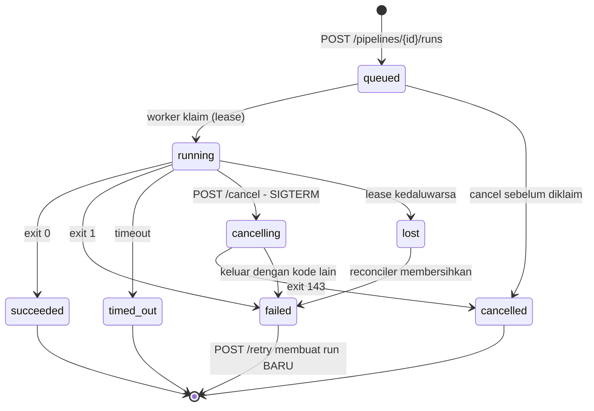

> Bagian 14 dari 16 - [Daftar Isi](README.md)

# 14. Referensi API Control Plane

Dokumen ini adalah **spesifikasi rancangan** untuk REST API control plane yang membungkus Meltano sebagai
execution engine (bagian 13). Semua yang berkaitan dengan Meltano disertai path dan baris; keputusan desain
API adalah rekomendasi.

Spesifikasi machine-readable: [`14-openapi.yaml`](14-openapi.yaml).

---

## 14.1 Konvensi Umum

### 14.1.1 Base URL dan versioning

```
https://api.example.com/v1
```

- Versi pada path: `/v1`. Breaking change -> `/v2`. **Jangan pernah mengubah semantik di path yang sama.**
- `Content-Type: application/json` untuk request/response; `application/problem+json` untuk error.
- Semua endpoint kecuali `/healthz` dan `/readyz` memerlukan autentikasi.

### 14.1.2 Autentikasi dan scope

```http
Authorization: Bearer <token>
```

Token memetakan ke `{ tenant_id, scopes }`. **Tenant selalu diambil dari token, bukan dari path atau body**,
sehingga tidak mungkin terjadi IDOR lintas tenant.

| Scope | Mengizinkan |
|---|---|
| `pipelines:read` | `GET` pada pipeline, connection, tenant |
| `pipelines:write` | `POST`/`PATCH`/`DELETE` pada pipeline dan connection |
| `runs:read` | `GET` run, log, event, state pipeline |
| `runs:execute` | `POST` run baru, `POST .../retry` |
| `runs:cancel` | `POST .../cancel` |
| `state:read` | `GET .../state` |
| `state:write` | `PUT`/`DELETE .../state` - **pisahkan dari `runs:execute`** |
| `admin` | Kelola tenant dan webhook endpoint |

### 14.1.3 Idempotency

Semua `POST` yang membuat resource menerima header `Idempotency-Key`. Khusus `POST .../runs`, header ini
**wajib**.

```http
Idempotency-Key: 7c1f0e2a-4b3d-4c9e-9f21-1a2b3c4d5e6f
```

- Key yang sama + body yang sama -> mengembalikan respons pertama (termasuk `run_id` yang sama), tidak
  membuat run baru.
- Key yang sama + body berbeda -> `409 Conflict`.
- Retensi key: 24 jam.

Ini penting karena kontrol konkurensi Meltano bersifat advisory
(`src/meltano/core/block/extract_load.py:527-538`), sehingga retry jaringan dari klien tidak boleh berubah
menjadi dua run paralel.

### 14.1.4 Paginasi

Semua endpoint list memakai cursor.

```http
GET /v1/runs?pipeline_id=pipe-123&status=failed&limit=50&cursor=eyJpZCI6...
```

| Parameter | Default | Batas |
|---|---|---|
| `limit` | 50 | 1-200 |
| `cursor` | - | opaque, dari `next_cursor` respons sebelumnya |

```json
{
  "data": [],
  "next_cursor": "eyJpZCI6IjZmMWMifQ",
  "has_more": true
}
```

### 14.1.5 Waktu

Semua timestamp: **RFC 3339 UTC** (`2026-10-16T02:11:04Z`). Durasi dalam detik (float).

### 14.1.6 Model error

RFC 7807 `application/problem+json`:

```json
{
  "type": "https://errors.example.com/active-run-conflict",
  "title": "Pipeline already has an active run",
  "status": 409,
  "detail": "pipeline pipe-123 has run 6f1c-8a2b in status running",
  "instance": "/v1/pipelines/pipe-123/runs",
  "active_run_id": "6f1c-8a2b"
}
```

Field `type`, `title`, `status` selalu ada. Field tambahan bersifat spesifik error.

| Code | Arti | Contoh pemicu |
|---|---|---|
| `200` | OK | GET sukses |
| `201` | Created | POST tenant/connection/pipeline/webhook |
| `202` | Accepted | Semua operasi eksekusi: mulai run, cancel, retry |
| `204` | No Content | DELETE sukses |
| `400` | Body malformed | JSON tidak valid, tipe salah |
| `401` | Unauthenticated | Token absen/kedaluwarsa |
| `403` | Forbidden | Scope kurang (`state:write` tanpa izin) |
| `404` | Not found | Resource tidak ada **dalam tenant token** |
| `409` | Conflict | Pipeline sudah punya run aktif; `Idempotency-Key` dipakai ulang dengan body berbeda |
| `422` | Unprocessable | `state_id_suffix` mengandung `:`; `extractor` tidak ada di project |
| `429` | Too Many Requests | Kuota tenant habis / rate limit |
| `503` | Service Unavailable | System DB tidak terjangkau; tidak ada worker hidup |

**Catatan `422`:** `state_id_suffix`, `environment`, `extractor`, dan `loader` **tidak boleh mengandung `:`**,
karena Meltano menolaknya dengan `RunnerError` (lihat `src/meltano/core/block/extract_load.py:925-929` dengan
`STATE_ID_COMPONENT_DELIMITER = ":"` di `src/meltano/core/constants.py:5`). Tangkap ini di API, jangan
biarkan menjadi kegagalan run.

### 14.1.7 Rate limit

```http
X-RateLimit-Limit: 1000
X-RateLimit-Remaining: 998
X-RateLimit-Reset: 1760572800
Retry-After: 12
```

`Retry-After` dikirim bersama `429` dan `503`.

---

## 14.2 Model Status Run

### 14.2.1 Enumerasi status

| Status | Kondisi | Padanan Meltano (terverifikasi) |
|---|---|---|
| `queued` | baris kontrol ada, belum diklaim worker | belum ada baris `runs` |
| `running` | proses `meltano` aktif | `runs.state = RUNNING` |
| `cancelling` | SIGTERM terkirim, menunggu exit | masih `RUNNING` |
| `succeeded` | `exit_code = 0` | `runs.state = SUCCESS` |
| `failed` | `exit_code = 1` | `runs.state = FAIL` |
| `cancelled` | `exit_code = 143` | `runs.state = FAIL` |
| `timed_out` | `exit_code = 1` + penanda log "Run timed out" | `runs.state = FAIL` |
| `lost` | lease kedaluwarsa, reconciler belum membersihkan | `runs.state = RUNNING` tanpa heartbeat baru |

Sumber enumerasi status Meltano: `Job.state` di `src/meltano/core/job/job.py:61-69`
(`IDLE`/`RUNNING`/`SUCCESS`/`FAIL`/`DEAD`/`STATE_EDIT`). Sumber exit code: `job/job.py:43` (143 untuk SIGTERM),
`src/meltano/cli/utils.py:54` (default 1), `src/meltano/cli/cli.py:172-181` (3).

### 14.2.2 State machine



Catatan: `failed`/`succeeded`/`cancelled`/`timed_out` bersifat **terminal dan immutable**. `POST /retry`
**tidak** mengubah run lama - ia membuat run baru yang merujuk `retried_from`. Ini mengikuti perilaku Meltano
yang tidak punya resume: run baru memuat `state.json` dari checkpoint terakhir
(`src/meltano/core/plugin/singer/tap.py:247-306`).

### 14.2.3 Kebijakan retry otomatis

| Exit code | Tindakan otomatis |
|---|---|
| `0` | -> `succeeded` |
| `1` | retry bila `attempt < max_attempts` -> `queued` dengan backoff eksponensial; selain itu `failed` |
| `3` | -> `failed`, **jangan retry**; versi Meltano tidak cocok dengan project |
| `143` | -> `cancelled` bila kita yang mengirim SIGTERM |
| lain | -> `failed` + alarm |

---

## 14.3 Referensi Endpoint

Total **34 endpoint**. Tabel di setiap subbagian memuat method, path, scope, dan padanan Meltano.

### 14.3.1 Meta

| Method | Path | Scope | Padanan Meltano |
|---|---|---|---|
| GET | `/healthz` | - | liveness proses |
| GET | `/readyz` | - | cek DB + queue + worker hidup |
| GET | `/v1/version` | any | `meltano --version` (`pyproject.toml:94`) |

`GET /v1/version` - deteksi mismatch sebelum job gagal dengan exit 3:

```json
{
  "control_plane": "0.4.2",
  "meltano": "4.4.1",
  "meltano_commit": "74725f257",
  "api_version": "v1"
}
```

`GET /readyz` -> `200` bila siap, `503` bila tidak:

```json
{
  "ready": false,
  "checks": {
    "job_store": { "ok": true, "latency_ms": 3 },
    "queue": { "ok": true, "pending": 12 },
    "system_db": { "ok": false, "error": "connection refused" },
    "workers": { "ok": true, "alive": 3, "capacity": 8 }
  }
}
```

### 14.3.2 Tenants

| Method | Path | Scope | Padanan Meltano |
|---|---|---|---|
| POST | `/v1/tenants` | admin | provisioning direktori project Meltano |
| GET | `/v1/tenants` | pipelines:read | - |
| GET | `/v1/tenants/{tenant_id}` | pipelines:read | - |
| PATCH | `/v1/tenants/{tenant_id}` | admin | - |
| DELETE | `/v1/tenants/{tenant_id}` | admin | - |

**POST /v1/tenants**

```json
{ "name": "acme", "display_name": "Acme Corp", "environment_name": "acme" }
```

-> `201 Created`

```json
{
  "id": "t-8f21",
  "name": "acme",
  "display_name": "Acme Corp",
  "environment_name": "acme",
  "project_dir": "/tenants/acme",
  "created_at": "2026-10-16T01:00:00Z"
}
```

`environment_name` inilah yang dipakai sebagai komponen pertama `state_id` (lihat 14.5.2). Satu tenant =
satu direktori project (bagian 13.7).

**DELETE** -> `204`, ditolak `409` bila masih ada run aktif pada tenant tersebut.

### 14.3.3 Connections

Koneksi **tidak pernah** menyimpan kredensial di API ini. Yang disimpan adalah `secret_ref`.

| Method | Path | Scope | Padanan Meltano |
|---|---|---|---|
| POST | `/v1/connections` | pipelines:write | entri plugin di `meltano.yml` |
| GET | `/v1/connections` | pipelines:read | - |
| GET | `/v1/connections/{connection_id}` | pipelines:read | - |
| PATCH | `/v1/connections/{connection_id}` | pipelines:write | - |
| DELETE | `/v1/connections/{connection_id}` | pipelines:write | - |
| POST | `/v1/connections/{connection_id}/test` | pipelines:write | spawn dengan `--dry-run` |

**POST /v1/connections**

```json
{
  "name": "prod-orders-postgres",
  "kind": "source",
  "driver": "postgres",
  "endpoint": { "host": "db.internal", "port": 5432, "database": "orders" },
  "username": "replication_ro",
  "secret_ref": "vault://kv/data/replication/prod-orders#password",
  "options": { "ssl_mode": "require" }
}
```

| Field | Wajib | Catatan |
|---|---|---|
| `name` | ya | unik per tenant |
| `kind` | ya | `source` atau `destination` |
| `driver` | ya | `postgres`, `mysql`, `mssql`, `oracle` (bertahap, bagian 10) |
| `endpoint` | ya | host/port/database/service name - **bukan** kredensial |
| `username` | ya | bukan rahasia, tapi tetap tidak perlu dikembalikan |
| `secret_ref` | ya | referensi ke secret manager; **nilai tidak pernah dikirim ke API** |
| `options` | tidak | parameter driver tambahan |

**Respons** tidak pernah memuat nilai secret:

```json
{
  "id": "conn-1a2b",
  "name": "prod-orders-postgres",
  "kind": "source",
  "driver": "postgres",
  "endpoint": { "host": "db.internal", "port": 5432, "database": "orders" },
  "username": "replication_ro",
  "secret_ref": "vault://kv/data/replication/prod-orders#password",
  "created_at": "2026-10-16T01:05:00Z"
}
```

**POST .../test** -> `200`:

```json
{
  "ok": true,
  "latency_ms": 42,
  "server_version": "16.4",
  "checked_at": "2026-10-16T01:06:00Z"
}
```

Alasan memakai `secret_ref` dan bukan nilai: **worker** yang me-resolve kredensial saat spawn. API hanya
menyimpan referensi sehingga kredensial tidak pernah masuk database control plane dan tidak pernah masuk
antrean.

### 14.3.4 Pipelines

| Method | Path | Scope | Padanan Meltano |
|---|---|---|---|
| POST | `/v1/pipelines` | pipelines:write | **tidak memanggil Meltano** - hanya INSERT ke DB Anda |
| GET | `/v1/pipelines` | pipelines:read | - |
| GET | `/v1/pipelines/{pipeline_id}` | pipelines:read | - |
| PATCH | `/v1/pipelines/{pipeline_id}` | pipelines:write | - |
| DELETE | `/v1/pipelines/{pipeline_id}` | pipelines:write | - |
| POST | `/v1/pipelines/{pipeline_id}/validate` | runs:execute | `meltano ... run --dry-run --no-install` |
| GET | `/v1/pipelines/{pipeline_id}/state` | state:read | `meltano state get <state_id>` |
| PUT | `/v1/pipelines/{pipeline_id}/state` | state:write | `meltano state set <state_id> ...` |
| DELETE | `/v1/pipelines/{pipeline_id}/state` | state:write | `meltano state clear <state_id>` |

**POST /v1/pipelines**

```json
{
  "name": "orders-cdc",
  "extractor": "tap-postgres",
  "loader": "target-postgres",
  "source_connection_id": "conn-1a2b",
  "destination_connection_id": "conn-9z8y",
  "state_id_suffix": null,
  "default_timeout_seconds": 3600,
  "max_attempts": 3,
  "schedule": { "cron": "0 */2 * * *", "enabled": true },
  "enabled": true
}
```

| Field | Wajib | Catatan |
|---|---|---|
| `name` | ya | unik per tenant |
| `extractor` | ya | harus cocok nama plugin di `meltano.yml` tenant |
| `loader` | ya | idem |
| `source_connection_id` | ya | untuk resolusi kredensial saat spawn |
| `destination_connection_id` | ya | idem |
| `state_id_suffix` | tidak | **tidak boleh mengandung `:`** -> `422` |
| `default_timeout_seconds` | tidak | default 3600 -> `--timeout` |
| `max_attempts` | tidak | default 3 |
| `schedule.cron` | tidak | hanya jika scheduler internal dipakai |
| `enabled` | tidak | default `true` |

Penting: `extractor`/`loader` dikirim sebagai **argumen posisional** ke `meltano run`, bukan ditulis ke
`meltano.yml`. Karena itu definisi pipeline hidup di DB Anda dan project tetap read-only (bagian 13.7).

**POST /v1/pipelines/{id}/validate** -> `200` (tanpa efek samping, tidak mengubah state):

```json
{
  "valid": true,
  "checks": [
    { "name": "project_readable", "ok": true },
    { "name": "extractor_present", "ok": true },
    { "name": "loader_present", "ok": true },
    { "name": "state_id_suffix_charset", "ok": true },
    { "name": "connections_reachable", "ok": true }
  ],
  "resolved_state_id": "acme:tap-postgres-to-target-postgres"
}
```

`resolved_state_id` memakai formula di 14.5.2. Bila tidak valid -> `200` dengan `valid: false`, atau `422`
bila pelanggarannya struktural (mis. suffix mengandung `:`).

**GET /v1/pipelines/{id}/state** -> `200`:

```json
{
  "pipeline_id": "pipe-123",
  "state_id": "acme:tap-postgres-to-target-postgres",
  "updated_at": "2026-10-16T02:12:31Z",
  "completed": { "singer_state": { "bookmarks": { "orders": { "replication_key_value": "2026-10-15T22:00:00Z" } } } },
  "partial": {}
}
```

Bentuk `completed`/`partial` mengikuti `MeltanoState.to_dict()` di `src/meltano/core/state_store/base.py:80-82`.
Nilai yang dikembalikan `meltano state get` adalah state *merged* (partial di atas completed,
`src/meltano/core/state_store/base.py:92-98`); API ini memilih menampilkan keduanya terpisah agar terlihat
mana yang belum lengkap.

**DELETE /v1/pipelines/{id}/state** - **destruktif**. Wajib: scope `state:write`, header
`X-Confirm-Destructive: <pipeline_id>`, dan dicatat di audit log dengan aktor + alasan.

-> `204`. Efek: pipeline berikutnya mulai dari nol.

### 14.3.5 Runs

| Method | Path | Scope | Padanan Meltano |
|---|---|---|---|
| POST | `/v1/pipelines/{pipeline_id}/runs` | runs:execute | spawn `meltano ... run ...` |
| GET | `/v1/runs` | runs:read | tabel `runs` / `meltano logs list --format json` |
| GET | `/v1/runs/{run_id}` | runs:read | idem |
| POST | `/v1/runs/{run_id}/cancel` | runs:cancel | SIGTERM -> exit 143 |
| POST | `/v1/runs/{run_id}/retry` | runs:execute | spawn run baru |
| GET | `/v1/runs/{run_id}/logs` | runs:read | `<user_log_path>/meltano/Logs/elt/<state_id-disaring>/<run_id>/elt.log` |
| GET | `/v1/runs/{run_id}/events` | runs:read | turunan control plane |
| GET | `/v1/runs/{run_id}/state` | runs:read | `meltano state get` (snapshot saat run itu) |

**POST /v1/pipelines/{pipeline_id}/runs**

```http
POST /v1/pipelines/pipe-123/runs
Idempotency-Key: 7c1f0e2a-4b3d-4c9e-9f21-1a2b3c4d5e6f
Content-Type: application/json
```

```json
{
  "full_refresh": false,
  "refresh_catalog": false,
  "state_id_suffix": null,
  "timeout_seconds": 3600,
  "trigger": "manual",
  "reason": "weekly backfill ticket OPS-4471"
}
```

| Field | Wajib | Memetakan ke |
|---|---|---|
| `full_refresh` | tidak | `--full-refresh` (`src/meltano/cli/run.py:56-65`) |
| `refresh_catalog` | tidak | `--refresh-catalog` (`src/meltano/cli/run.py:66-72`) |
| `state_id_suffix` | tidak | `--state-id-suffix` (`src/meltano/cli/run.py:90-95`) |
| `timeout_seconds` | tidak | `--timeout` (`src/meltano/cli/run.py:117-126`) |
| `trigger` | tidak | label internal Anda; dikirim juga ke `MELTANO_JOB_TRIGGER` |
| `reason` | tidak | hanya untuk audit log |

Field `force` **sengaja tidak ada** - lihat 14.8.

-> `202 Accepted` dengan header `Location: /v1/runs/{run_id}`:

```json
{
  "id": "6f1c-8a2b",
  "pipeline_id": "pipe-123",
  "status": "queued",
  "attempt": 1,
  "trigger": "manual",
  "meltano": {
    "environment": "acme",
    "extractor": "tap-postgres",
    "loader": "target-postgres",
    "state_id": "acme:tap-postgres-to-target-postgres",
    "run_id": "6f1c-8a2b",
    "project_dir": "/tenants/acme"
  },
  "created_at": "2026-10-16T02:11:04Z"
}
```

`409` bila pipeline sudah punya run aktif:

```json
{
  "type": "https://errors.example.com/active-run-conflict",
  "title": "Pipeline already has an active run",
  "status": 409,
  "detail": "pipeline pipe-123 has run 6f1c-8a2b in status running",
  "instance": "/v1/pipelines/pipe-123/runs",
  "active_run_id": "6f1c-8a2b"
}
```

**GET /v1/runs/{run_id}**

```json
{
  "id": "6f1c-8a2b",
  "pipeline_id": "pipe-123",
  "status": "running",
  "attempt": 1,
  "retried_from": null,
  "exit_code": null,
  "error": null,
  "created_at": "2026-10-16T02:11:04Z",
  "started_at": "2026-10-16T02:11:05Z",
  "ended_at": null,
  "duration_seconds": null,
  "progress": {
    "last_checkpoint_at": "2026-10-16T02:12:31Z",
    "state_age_seconds": 12,
    "log_bytes": 48213
  },
  "meltano": {
    "state_id": "acme:tap-postgres-to-target-postgres",
    "run_id": "6f1c-8a2b"
  }
}
```

`progress.state_age_seconds` adalah indikator lag paling jujur yang bisa diberikan control plane - Meltano
tidak mengekspos persentase progres apa pun (bagian 13.12).

**GET /v1/runs** - filter: `pipeline_id`, `status` (boleh berulang), `from`, `to`, `trigger`, `cursor`, `limit`.

**POST /v1/runs/{run_id}/cancel** -> `202`. Idempoten: memanggil ulang pada run `cancelling` atau status
terminal mengembalikan `202`/`200` tanpa efek tambahan.

```json
{ "status": "cancelling", "cancel_requested_at": "2026-10-16T02:13:00Z" }
```

Rantai yang terjadi: SIGTERM ke proses group -> handler `_handling_sigterm`
(`src/meltano/core/job/job.py:448-496`) -> `terminate()` pada tap/target
(`src/meltano/core/block/singer.py:334-349`) -> exit `143` (`src/meltano/core/job/job.py:43`).

**POST /v1/runs/{run_id}/retry** -> `202`; membuat run **baru**:

```json
{ "id": "9d4e-1f7a", "retried_from": "6f1c-8a2b", "status": "queued", "attempt": 1 }
```

`409` bila masih ada run aktif pada pipeline. `attempt` pada run baru dimulai dari 1 karena ini run baru,
bukan kelanjutan; jumlah percobaan otomatis disimpan terpisah pada field `auto_attempts`.

**GET /v1/runs/{run_id}/logs**

```http
GET /v1/runs/6f1c-8a2b/logs?tail=200
Accept: text/plain
```

-> `200` `text/plain`, atau `404` dengan `type=.../log-not-found` bila log sudah dibersihkan.

Streaming:

```http
GET /v1/runs/6f1c-8a2b/logs?follow=true
Accept: text/event-stream
```

```
event: log
data: {"at":"2026-10-16T02:11:07Z","stream":"stderr","line":"INFO Starting sync"}

event: checkpoint
data: {"at":"2026-10-16T02:12:31Z","stream":"orders","value":"2026-10-15T22:00:00Z"}

event: end
data: {"status":"succeeded","exit_code":0}
```

**GET /v1/runs/{run_id}/events**

```json
{
  "data": [
    { "at": "2026-10-16T02:11:04Z", "kind": "phase", "payload": { "phase": "queued" } },
    { "at": "2026-10-16T02:11:05Z", "kind": "phase", "payload": { "phase": "running", "worker": "w-3" } },
    { "at": "2026-10-16T02:12:31Z", "kind": "state_checkpoint", "payload": { "stream": "orders" } },
    { "at": "2026-10-16T02:14:02Z", "kind": "phase", "payload": { "phase": "succeeded" } }
  ],
  "next_cursor": null,
  "has_more": false
}
```

### 14.3.6 Webhook endpoints

| Method | Path | Scope | Padanan Meltano |
|---|---|---|---|
| POST | `/v1/webhook_endpoints` | admin | tidak ada di Meltano |
| GET | `/v1/webhook_endpoints` | admin | - |
| DELETE | `/v1/webhook_endpoints/{webhook_id}` | admin | - |

```json
{
  "url": "https://customer.example.com/hooks/replication",
  "events": ["run.succeeded", "run.failed", "run.timed_out"],
  "secret_ref": "vault://kv/data/webhooks/customer-acme#hmac"
}
```

Payload:

```json
{
  "id": "evt-4a3b",
  "type": "run.failed",
  "created_at": "2026-10-16T02:14:02Z",
  "data": {
    "run_id": "6f1c-8a2b",
    "pipeline_id": "pipe-123",
    "status": "failed",
    "exit_code": 1,
    "error": "Extractor failed",
    "duration_seconds": 177.0
  }
}
```

Header:

```http
X-Webhook-Id: evt-4a3b
X-Webhook-Timestamp: 1760573642
X-Webhook-Signature: v1=<hex(hmac_sha256(secret, timestamp + "." + body))>
```

Kebijakan: retry 3x dengan backoff (1s, 10s, 60s), timeout 10 detik, idempotent terhadap `X-Webhook-Id`.

---

## 14.4 Skema Objek

Skema lengkap dan mesin-terbaca ada di [`14-openapi.yaml`](14-openapi.yaml). Ringkasan field penting:

### Run

| Field | Tipe | Keterangan |
|---|---|---|
| `id` | uuid | dipakai sebagai `--run-id` **dan** `MELTANO_JOB_TRIGGER` |
| `pipeline_id` | uuid | |
| `status` | enum | lihat 14.2.1 |
| `attempt` | int | percobaan otomatis untuk run ini |
| `auto_attempts` | int | jumlah percobaan otomatis yang sudah dijalankan |
| `retried_from` | uuid atau null | run yang memicu retry |
| `exit_code` | int atau null | exit code proses `meltano` |
| `error` | string atau null | pesan terminal |
| `meltano.state_id` | string | **dihitung control plane**, bukan dari Meltano |
| `meltano.run_id` | uuid | sama dengan `id` |
| `meltano.project_dir` | string | `cwd` proses |
| `progress.last_checkpoint_at` | timestamp | kapan state terakhir berubah |
| `progress.state_age_seconds` | int | indikator lag |

### Pipeline

| Field | Tipe | Keterangan |
|---|---|---|
| `id`, `tenant_id`, `name` | | |
| `extractor`, `loader` | string | nama plugin di `meltano.yml` |
| `source_connection_id`, `destination_connection_id` | uuid | resolusi kredensial saat spawn |
| `state_id_suffix` | string atau null | tanpa `:` |
| `default_timeout_seconds`, `max_attempts` | int | kebijakan eksekusi |
| `active_run_id` | uuid atau null | diisi saat ada run aktif (dasar `409`) |

### Connection

| Field | Tipe | Keterangan |
|---|---|---|
| `id`, `tenant_id`, `name` | | |
| `kind` | enum | `source` atau `destination` |
| `driver` | enum | `postgres`, `mysql`, `mssql`, `oracle` |
| `endpoint` | object | host/port/database - bukan kredensial |
| `username` | string | |
| `secret_ref` | string | **referensi**, bukan nilai |
| `options` | object | parameter driver |

---

## 14.5 Pemetaan Lengkap API ke Meltano

### 14.5.1 Dari request ke argv proses

```go
argv := []string{
    "meltano",
    "--environment=" + spec.Environment,   // grup cli: src/meltano/cli/cli.py:80
    "--log-format=json",                   // grup cli: src/meltano/cli/cli.py:70-74
    "run",
    spec.Extractor,                        // argumen posisional
    spec.Loader,
    "--run-id=" + spec.RunID.String(),     // src/meltano/cli/run.py:110-116
    "--timeout=" + strconv.Itoa(spec.TimeoutSeconds),
    "--no-install",                        // src/meltano/cli/run.py:132
}
if spec.StateIDSuffix != "" {
    argv = append(argv, "--state-id-suffix="+spec.StateIDSuffix)
}
if spec.FullRefresh {
    argv = append(argv, "--full-refresh")
}
if spec.RefreshCatalog {
    argv = append(argv, "--refresh-catalog")
}
```

| Field API | Mekanisme Meltano | Bukti |
|---|---|---|
| `environment` | `--environment` (opsi grup, **sebelum** subcommand) | `cli/cli.py:80-86` |
| `extractor`, `loader` | argumen posisional `run` | `cli/run.py:127-130` |
| `run_id` | `--run-id` dan env `MELTANO_RUN_ID` | `cli/run.py:110-116` |
| `timeout_seconds` | `--timeout` dan env `MELTANO_RUN_TIMEOUT` | `cli/run.py:117-126` |
| `state_id_suffix` | `--state-id-suffix` dan env `MELTANO_RUN_STATE_ID_SUFFIX` | `cli/run.py:90-95` |
| `full_refresh` | `--full-refresh` dan env `MELTANO_RUN_FULL_REFRESH` | `cli/run.py:56-65` |
| `refresh_catalog` | `--refresh-catalog` dan env `MELTANO_RUN_REFRESH_CATALOG` | `cli/run.py:66-72` |
| `trigger`/`run_id` | env `MELTANO_JOB_TRIGGER` -> kolom `runs.trigger` | `cli/__init__.py:147`, `job/job.py:103-109,144` |
| `secret_ref` | di-resolve worker -> env var plugin | `plugin_invoker.py:375-453` |
| `validate` | `--dry-run` | `cli/run.py:48-55` |
| `cancel` | SIGTERM | `job/job.py:448-496` |
| `state:read` | `meltano state get <state_id>` | `cli/state.py:329-351` |
| `state:write` | `meltano state set <state_id> ...` | `cli/state.py:265` |
| `state:delete` | `meltano state clear <state_id>` | `cli/state.py:439` |

Env var yang selalu diset worker:

```go
env := append(os.Environ(),
    "MELTANO_JOB_TRIGGER="+runID.String(),
    "MELTANO_PROJECT_READONLY=true",             // core/project.py:60
    "MELTANO_AUTO_INSTALL=false",                // bundle/settings.yml:52-55
    // CATATAN: MELTANO_FF_STRICT_ENV_VAR_MODE sengaja tidak diset di sini.
    // Mode itu mematahkan plugin nyata - lihat doc 15 bagian 15.7.2.
    "MELTANO_SEND_ANONYMOUS_USAGE_STATS=false",  // bundle/settings.yml:7-10
)
```

### 14.5.2 Perhitungan `state_id`

`meltano run` **tidak** menerima `--state-id` penuh - daftar opsinya hanya memuat `--state-id-suffix`
(`src/meltano/cli/run.py:48-130`). Nilainya dihitung oleh Meltano di
`src/meltano/core/block/extract_load.py:894-931`:

```python
state_id_components = [
    project.environment.name,
    f"{consumer.string_id}-to-{producer.string_id}",   # consumer=head=extractor, producer=tail=loader
    state_id_suffix or project.environment.state_id_suffix,
]
if any(c for c in state_id_components if c and STATE_ID_COMPONENT_DELIMITER in c):
    raise RunnerError("Cannot generate a state ID from components containing the delimiter ...")
return STATE_ID_COMPONENT_DELIMITER.join(c for c in state_id_components if c)
```

Dengan `STATE_ID_COMPONENT_DELIMITER = ":"` (`src/meltano/core/constants.py:5`), control plane **wajib**
menghitung string identik di Go:

```go
func StateID(environment, extractor, loader, suffix string) (string, error) {
    parts := []string{environment, extractor + "-to-" + loader}
    if suffix != "" {
        parts = append(parts, suffix)
    }
    for _, p := range parts {
        if strings.Contains(p, ":") {
            return "", fmt.Errorf("komponen state_id tidak boleh mengandung ':': %q", p)
        }
    }
    return strings.Join(parts, ":"), nil
}

// StateID("acme", "tap-postgres", "target-postgres", "")
//   -> "acme:tap-postgres-to-target-postgres"
```

String ini dipakai untuk tiga hal: `meltano state get <state_id>`, menyusun path log
`<user_log_path>/meltano/Logs/elt/<state_id-disaring>/<run_id>/elt.log`
(`src/meltano/core/project_dirs_service.py:128-140,167-188` - nama folder disaring `sanitize_filename`), dan
mencocokkan baris `runs.job_name` di system DB.

### 14.5.3 Dari status Meltano ke status API

| Sumber Meltano | Nilai | Status API |
|---|---|---|
| exit code | `0` | `succeeded` |
| exit code | `1` | `failed` (atau `timed_out` bila log memuat "Run timed out") |
| exit code | `3` | `failed` + alarm versi |
| exit code | `143` | `cancelled` |
| `runs.state` | `RUNNING` | `running` |
| `runs.state` | `SUCCESS` | `succeeded` |
| `runs.state` | `FAIL` | `failed` |
| lease `job_runs` kedaluwarsa | - | `lost` -> `failed` setelah reconciler |

### 14.5.4 Sumber data untuk setiap endpoint baca

| Endpoint | Sumber tercepat | Alternatif |
|---|---|---|
| `GET /v1/runs/{id}` | tabel `job_runs` (DB Anda) | tabel `runs` Meltano |
| `GET /v1/runs/{id}/logs` | file `<user_log_path>/meltano/Logs/elt/.../elt.log` (**di luar project**) | `meltano logs show <run_id>` atau `meltano logs dir` |
| `GET /v1/runs` | tabel `job_runs` | `meltano logs list --format json` |
| `GET /v1/pipelines/{id}/state` | `meltano state get` | tabel `state` |

---

## 14.6 Kontrak Log Streaming (SSE)

| Aspek | Nilai |
|---|---|
| Transport | `text/event-stream` |
| Event | `log`, `checkpoint`, `phase`, `end`, `heartbeat` |
| Heartbeat | komentar `: ping` setiap 15 detik agar koneksi tidak diputus proxy |
| Reconnect | klien mengirim `Last-Event-ID`; server melanjutkan dari offset byte |
| Idle run | koneksi tetap terbuka sampai status terminal, lalu `event: end` dan tutup |

Sumber stream adalah file log per run (`elt.log`). Karena itu `Last-Event-ID` sebaiknya berisi offset byte,
bukan nomor baris - tahan terhadap rotasi log.

---

## 14.7 Keamanan API

| Kontrol | Implementasi |
|---|---|
| Tenant isolation | `tenant_id` dari token, selalu ditambahkan sebagai filter query |
| Kredensial | API menyimpan `secret_ref`; **tidak pernah** nilai. Worker resolve saat spawn |
| Redaksi log | pola `password`, `secret`, `token`, `apikey` disaring sebelum log dibalas |
| Idempotency | `Idempotency-Key` wajib pada `POST .../runs` |
| Operasi destruktif | `DELETE .../state` butuh header konfirmasi + scope terpisah + audit log |
| Rate limit | per token dan per tenant |
| Audit | setiap `POST`/`PATCH`/`DELETE` dicatat: aktor, IP, resource, body tanpa kredensial |
| Request ID | `X-Request-Id` diterima atau dibuat, dikembalikan di header dan log |

Yang **tidak boleh** dilakukan API:

- mengirim nilai kredensial ke worker lewat antrean - resolve di worker, bukan di API;
- mengembalikan `secret_ref` lengkap ke klien non-admin;
- mengekspos stack trace; selalu balas problem+json;
- mengekspos `--force`.

---

## 14.8 Yang Sengaja Tidak Ada di API

| Tidak ada | Alasan | Bukti |
|---|---|---|
| `POST /v1/runs/{id}/resume` | Meltano tidak punya resume; yang ada run baru dengan state lama | `src/meltano/core/plugin/singer/tap.py:247-306` |
| Field `force` pada request run | mematikan satu-satunya pengaman yang ada | `src/meltano/cli/run.py:80-89` |
| `PATCH /v1/runs/{id}` | run immutable kecuali transisi status internal | - |
| Kredensial di body `connections` | config connector ditulis ke disk saat run | `src/meltano/core/plugin/config_service.py:39-54` |
| Endpoint tulis `meltano.yml` | project harus read-only | `src/meltano/core/project.py:339-340` |
| `POST /v1/runs/{id}/cancel-sync` | pembatalan selalu asinkron (SIGTERM) | `src/meltano/core/job/job.py:448-496` |
| Progres persentase | Meltano tidak mengekspos progres; hanya log dan STATE | bagian 13.12 |
| Streaming sebagian baris log | log berbasis baris; potongan tidak bermakna | `src/meltano/core/logging/utils.py:341-367` |

---

## 14.9 Contoh Alur Lengkap

```bash
# 1. Provision tenant
curl -X POST https://api.example.com/v1/tenants \
  -H "Authorization: Bearer $TOKEN" -H 'Content-Type: application/json' \
  -d '{"name":"acme","environment_name":"acme"}'

# 2. Daftarkan koneksi (hanya referensi secret)
curl -X POST https://api.example.com/v1/connections \
  -H "Authorization: Bearer $TOKEN" -H 'Content-Type: application/json' \
  -d '{"name":"orders-src","kind":"source","driver":"postgres",
       "endpoint":{"host":"db.internal","port":5432,"database":"orders"},
       "username":"replication_ro",
       "secret_ref":"vault://kv/data/replication/prod-orders#password"}'

# 3. Definisikan pipeline
curl -X POST https://api.example.com/v1/pipelines \
  -H "Authorization: Bearer $TOKEN" -H 'Content-Type: application/json' \
  -d '{"name":"orders-sync","extractor":"tap-postgres","loader":"target-postgres",
       "source_connection_id":"conn-1a2b","destination_connection_id":"conn-9z8y",
       "default_timeout_seconds":3600,"max_attempts":3}'

# 4. Validasi tanpa eksekusi
curl -X POST https://api.example.com/v1/pipelines/pipe-123/validate \
  -H "Authorization: Bearer $TOKEN"

# 5. Jalankan
curl -X POST https://api.example.com/v1/pipelines/pipe-123/runs \
  -H "Authorization: Bearer $TOKEN" \
  -H 'Idempotency-Key: 7c1f0e2a-4b3d-4c9e-9f21-1a2b3c4d5e6f' \
  -H 'Content-Type: application/json' \
  -d '{"timeout_seconds":3600,"trigger":"manual"}'
# -> 202 {"id":"6f1c-8a2b","status":"queued", ...}

# 6. Ikuti status
curl https://api.example.com/v1/runs/6f1c-8a2b -H "Authorization: Bearer $TOKEN"

# 7. Ikuti log
curl -N "https://api.example.com/v1/runs/6f1c-8a2b/logs?follow=true" \
  -H "Authorization: Bearer $TOKEN" -H 'Accept: text/event-stream'

# 8. Batalkan (bila perlu)
curl -X POST https://api.example.com/v1/runs/6f1c-8a2b/cancel \
  -H "Authorization: Bearer $TOKEN"

# 9. Coba ulang setelah gagal
curl -X POST https://api.example.com/v1/runs/6f1c-8a2b/retry \
  -H "Authorization: Bearer $TOKEN" \
  -H 'Idempotency-Key: a1b2c3d4-0000-0000-0000-000000000001'

# 10. Periksa state
curl https://api.example.com/v1/pipelines/pipe-123/state -H "Authorization: Bearer $TOKEN"
```

---

## 14.10 Catatan Implementasi

1. **Semua operasi eksekusi mengembalikan `202`.** Jangan pernah membuat handler yang menunggu job selesai -
   biaya startup proses Meltano dan durasi sync tidak cocok untuk request HTTP.
2. **`Idempotency-Key` pada `POST .../runs` wajib**, bukan opsional. Ini satu-satunya pertahanan terhadap
   duplikasi run dari retry klien, karena pengaman Meltano hanya query advisory
   (`src/meltano/core/block/extract_load.py:527-538`).
3. **Satu pipeline = satu run aktif** dijamin di level DB dengan partial unique index, bukan hanya di
   aplikasi:

   ```sql
   CREATE UNIQUE INDEX ux_one_active_run_per_pipeline
     ON job_runs (pipeline_id)
     WHERE status IN ('queued', 'running', 'cancelling');
   ```

4. **`409` bukan `429`.** Konflik run aktif adalah kesalahan klien yang harus diperbaiki, bukan backoff.
5. **Jangan menormalkan exit code** menjadi hanya sukses/gagal; simpan apa adanya. Meltano sendiri
   menormalkan sebagian (`src/meltano/core/block/extract_load.py:725-733`), jadi informasi yang hilang di
   sana harus dikompensasi dengan menyimpan log tail.
6. **Log tail wajib disimpan** pada kegagalan (`error` + 100 baris terakhir), karena run dir bersifat
   ephemeral dan admin tidak akan bisa mereproduksi konteksnya.

---

## 14.11 Yang Perlu Diverifikasi Saat Implementasi

1. Bentuk persis JSON `meltano logs show <run_id> --format json` (`src/meltano/cli/logs.py:199-242`) -
   dokumen ini belum memuat strukturnya secara penuh.
2. Apakah `--run-id` benar-benar mengisi `runs.run_id` pada jalur `run`; dibaca dari
   `src/meltano/cli/run.py:110-116` dan `with_run_id` di
   `src/meltano/core/block/extract_load.py:226-236,367-368`, tetapi belum diuji dengan eksekusi nyata.
3. Perilaku path log bila `state_id` mengandung `:` pada worker Windows.
4. Apakah `environment_name` yang tidak dideklarasikan di `meltano.yml` membuat `meltano run` gagal - perlu
   diuji, karena environment memengaruhi `state_id` dan ketersediaan state.

---

*Dokumen ini bagian 14 dari analisis Meltano v4.4.1 (commit `74725f257`). Bagian 1-7 berisi temuan source
code; bagian 8-14 berisi rekomendasi desain.*

---

**Navigasi:** [Bagian 13](13-arsitektur-control-plane.md) - [Daftar Isi](README.md) - [Bagian 15](15-menjalankan-meltano.md)
