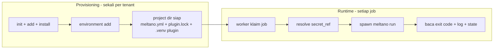

> Bagian 15 dari 16 - [Daftar Isi](README.md)

# 15. Menjalankan Meltano dan Menyambungkannya ke Control Plane

Dokumen ini adalah panduan operasional: cara memasang Meltano dari repository ini, cara provisioning project,
cara menjalankan pipeline, dan cara menyambungkannya ke control plane Go (bagian 13 dan 14).

Bagian 15.2 sampai 15.6 sudah **diuji langsung** pada mesin Windows dengan Git Bash pada 2026-10-16.
Bagian 15.7 adalah rancangan integrasi.

---

## 15.1 Prinsip: Dua Fase yang Harus Dipisahkan

Ini pembedaan terpenting, dan sumber sebagian besar kesalahan integrasi:

| Fase | Kapan | Perintah | Butuh network |
|---|---|---|---|
| **Provisioning** | sekali per tenant | `init`, `add`, `install`, `config set`, `environment add` | ya |
| **Runtime** | setiap job | `run`, `state get`, `logs list` | tidak |

Provisioning **menulis** ke `meltano.yml` dan `.meltano/`. Runtime **tidak boleh** menulis apa pun ke project —
karena itu project di-mount read-only di container worker (bagian 13.7) dan `MELTANO_PROJECT_READONLY=true`.

Kalau Anda mencampur keduanya, request user akan memicu unduhan dependency dan menulis ke file project.
Itu kesalahan yang paling mahal untuk diperbaiki belakangan.

---

## 15.2 Memasang Meltano dari Repository Ini

Repository ini adalah **source Meltano**, bukan project Meltano. Package-nya standar PEP 517 dengan entry point
`meltano = "meltano.cli:main"` (`pyproject.toml:94`) dan build backend `hatchling==1.32.4`
(`pyproject.toml:340-342`), jadi ia bisa dipasang langsung dari checkout.

### 15.2.1 Jalur A - venv + pip (terverifikasi)

Ini jalur yang paling sedikit gesekan di Windows, karena tidak memerlukan `uv` global:

```bash
cd /c/Users/User/Documents/devel/meltano
python -m venv .venv
source .venv/Scripts/activate          # Windows Git Bash
pip install -e ".[postgres]"
export PYTHONUTF8=1                    # lihat 15.3
meltano --version
```

Hasil yang diharapkan dan sudah diverifikasi:

```
meltano, version 4.4.1
```

Verifikasi bahwa kode benar-benar berasal dari repo, bukan dari PyPI:

```bash
python -c "import meltano.cli; print(meltano.cli.__file__)"
# C:\Users\User\Documents\devel\meltano\src\meltano\cli\__init__.py
```

Catatan penting: `uv` ikut terpasang **di dalam `.venv`** karena ia dependency Meltano sendiri
(`pyproject.toml:59` -> `"uv>=0.8.14"`). Jadi setelah aktivasi venv, `uv --version` berfungsi, tapi `uv`
tidak tersedia di shell luar. Itu normal dan tidak perlu diperbaiki.

### 15.2.2 Jalur B - uv global + `uv sync` (cara CI upstream)

CI Meltano menjalankan ini (`.github/workflows/integration_tests.yml:89` dan `:110`):

```bash
uv sync --extra postgres
uv run meltano --version
```

Keunggulan: memakai `uv.lock` (977 KB) sehingga versi dependency identik dengan yang diuji upstream.

**Peringatan versi Python:** `.python-version` di repo berisi `3.14`, sedangkan `requires-python = ">=3.10"`
(`pyproject.toml:6`). `uv` akan mengunduh CPython 3.14 sendiri. Kalau ingin memakai interpreter yang sudah ada:

```bash
uv sync --extra postgres --python 3.13
```

### 15.2.3 Jalur C - build wheel untuk produksi

```bash
uv build --wheel          # atau: pip wheel . --no-deps -w dist/
# dist/meltano-4.4.1-py3-none-any.whl
```

```dockerfile
FROM python:3.13-slim
COPY dist/meltano-4.4.1-py3-none-any.whl /tmp/
RUN pip install --no-cache-dir /tmp/meltano-4.4.1-py3-none-any.whl
```

Ini cara yang benar untuk produksi: image tidak berisi source, dan upgrade = ganti commit + rebuild.

### 15.2.4 Yang TIDAK boleh dilakukan

**Jangan jalankan `uv sync` pada `.venv` yang sudah dibuat dengan `python -m venv` dan sudah berjalan.**
`.venv` buatan `python -m venv` memakai Python 3.13, sedangkan `.python-version` repo meminta 3.14. `uv sync`
dapat membuat ulang atau merusak environment yang sudah bekerja. Kalau memang butuh uv-lock, lakukan di
direktori terpisah atau di container.

**Jangan pakai `uv sync --all-extras`** untuk mulai. Extra `mssql` menarik `pymssql` yang butuh kompilasi.
Pasang extra sesuai kebutuhan (`--extra postgres`, `--extra mssql`, seterusnya).

---

## 15.3 Wajib di Windows: `PYTHONUTF8=1`

Ini **bug nyata** yang akan Anda temui, bukan teori. Pada uji langsung, `meltano init` gagal dengan:

```
UnicodeEncodeError: 'charmap' codec can't encode characters in position 32-35:
character maps to <undefined>
```

Penyebabnya: Meltano memakai `rich` untuk output konsol dengan karakter box-drawing Unicode, sedangkan code
page konsol Windows adalah `Windows-1252`. Project tetap terbentuk, tetapi exit code-nya non-zero sehingga
otomasi Anda akan menganggapnya gagal.

Perbaikan yang sudah diuji:

| Setting | Hasil uji |
|---|---|
| `PYTHONUTF8=1` | exit code **0** |
| `PYTHONIOENCODING=utf-8` | exit code **0** |
| tanpa keduanya | exit code non-zero + `UnicodeEncodeError` |

Permanen di Git Bash (tambahkan ke `~/.bashrc`):

```bash
export PYTHONUTF8=1
```

**Untuk worker Go:** tambahkan `PYTHONUTF8=1` ke `cmd.Env` bila worker berjalan di Windows (lihat 15.7.2).

Catatan: kode Meltano sebenarnya menyediakan `SafeStreamHandler` untuk masalah ini
(`src/meltano/core/logging/utils.py:43-81`), tetapi docstring-nya menyatakan handler itu **tidak dipakai
secara default** dan harus diaktifkan lewat `logging.yaml` kustom. `PYTHONUTF8=1` adalah jalan tercepat.

---

## 15.4 Provisioning Project (Sekali per Tenant)

### Langkah 1 - Buat project

```bash
M=/c/Users/User/Documents/devel/meltano/.venv/Scripts/meltano.exe
export PYTHONUTF8=1

cd /srv/tenants
$M init acme --no-usage-stats
cd acme
```

`init` menerima `--no-usage-stats`, `--force`, dan `--database-uri` (`src/meltano/cli/initialize.py:26-46`).

Struktur yang dihasilkan (terverifikasi):

```
acme/
├── .meltano/            # database sistem, venv plugin, run dir
│   ├── meltano.db       # SQLite system database
│   ├── extractors/      # venv tiap tap
│   ├── loaders/         # venv tiap target
│   └── run/             # run dir per job (config + state sementara)
├── output/
├── meltano.yml
├── README.md
├── requirements.txt
├── .gitignore
├── analyze/  extract/  load/  notebook/  orchestrate/  output/  transform/
```

Isi `meltano.yml` hasil `init` (terverifikasi):

```yaml
default_environment: dev
project_id: 01a14430-68a3-711f-9618-8f197b340bae
environments:
- name: dev
- name: staging
- name: prod
send_anonymous_usage_stats: false
```

Perhatikan: `init` otomatis membuat tiga environment dan `default_environment: dev`. Ini juga menjelaskan
kenapa semua project contoh di `integration/example-library/` punya tiga environment yang sama.

### Langkah 2 - Tambah connector

```bash
$M add extractor tap-postgres
$M add loader target-postgres
```

`add` mendukung `--plugin-type`, `--variant`, `--as`, `--from-ref`, `--custom`, dan `--python`
(`src/meltano/cli/add.py:60-117`). Tanpa opsi tambahan, definisi plugin diambil dari Meltano Hub
(`hub_url` default `https://hub.meltano.com`, `src/meltano/core/bundle/settings.yml:41-43`) sehingga langkah
ini **butuh jaringan**.

Perintah ini menulis ke `meltano.yml` - jadi hanya boleh dijalankan saat provisioning.

### Langkah 3 - Install plugin

```bash
$M install
```

`install` menerima `--plugin-type`, `--clean`, `--parallelism`, `--force`, dan `--schedule`
(`src/meltano/cli/install.py:28-52`). Ini membuat venv terisolasi per plugin dan merupakan langkah **paling
lama**. Di produksi, jalankan saat build image.

### Langkah 4 - Konfigurasi koneksi

Jangan menyimpan kredensial di `meltano.yml`. Dua cara yang benar:

```bash
# Non-rahasia boleh lewat config (tersimpan di meltano.yml)
# PERHATIKAN urutannya: subcommand `set` DULU, baru nama plugin
$M config set tap-postgres host db.internal
$M config set tap-postgres port 5432
$M config set tap-postgres user replication_ro

# Rahasia lewat env var (prioritas lebih tinggi dari meltano.yml)
export TAP_POSTGRES_PASSWORD=...
export TARGET_POSTGRES_PASSWORD=...
# JANGAN set MELTANO_FF_STRICT_ENV_VAR_MODE di sini - lihat 15.7.2
```

Nama env var per plugin mengikuti `ProjectPlugin.env_prefixes`
(`src/meltano/core/plugin/project_plugin.py:286-302`): `TAP_POSTGRES_*` dan `MELTANO_EXTRACT_*` untuk tap,
`TARGET_POSTGRES_*` dan `MELTANO_LOAD_*` untuk target. Detail lengkap ada di bagian 13.9.1.

### Langkah 5 - Environment

`init` sudah membuat `dev`/`staging`/`prod`. Untuk tenant yang butuh environment sendiri:

```bash
$M environment add tenant-acme
```

Environment menentukan komponen pertama `state_id`, jadi putuskan penamaannya sebelum produksi
(lihat 15.7.3).

### Skrip provisioning lengkap

```bash
#!/usr/bin/env bash
# provision-tenant.sh <tenant-name> <project-root>
set -euo pipefail

TENANT="$1"
ROOT="${2:-/srv/tenants}"
MELTANO="${MELTANO_BIN:-/opt/meltano/.venv/bin/meltano}"

export PYTHONUTF8=1
export MELTANO_SEND_ANONYMOUS_USAGE_STATS=false
# Catatan: MELTANO_FF_STRICT_ENV_VAR_MODE sengaja tidak diset (lihat 15.7.2).

PROJECT="$ROOT/$TENANT"
[ -e "$PROJECT" ] && { echo "sudah ada: $PROJECT"; exit 1; }

mkdir -p "$ROOT"
cd "$ROOT"
"$MELTANO" init "$TENANT" --no-usage-stats
cd "$PROJECT"

"$MELTANO" add extractor "${EXTRACTOR:-tap-postgres}"
"$MELTANO" add loader    "${LOADER:-target-postgres}"
"$MELTANO" install

"$MELTANO" environment add "$TENANT"

# kontrol akhir: pastikan project bisa dibaca dan CLI sehat
"$MELTANO" --environment="$TENANT" config meltano list --format=json > /dev/null
echo "provision selesai: $PROJECT"
```

Simpan sebagai `scripts/provision-tenant.sh` dan jalankan sekali per tenant. Skrip ini **tidak** menyentuh
kredensial - itu tugas worker saat spawn.

---

## 15.5 Menjalankan Pipeline

### Prasyarat: environment wajib

Ini sumber kegagalan pertama yang paling sering. `meltano run` dideklarasikan dengan
`environment_required` (`src/meltano/cli/run.py:46`), dan enum-nya berbunyi *"Use explicit environment, or
`default_environment`, or **fail**"* (`src/meltano/cli/utils.py:523-527`). Tanpa environment aktif,
`job = None` sehingga **tidak ada state sama sekali** (`src/meltano/core/block/extract_load.py:356-357`).

Kalau `meltano.yml` punya `default_environment: dev` (seperti hasil `init`), environment otomatis aktif.
Kalau tidak, sertakan `--environment`.

### Urutan argumen

Opsi tingkat grup harus **mendahului** subcommand:

```
meltano [opsi grup] run <extractor> <loader> [opsi run]
         ^^^^^^^^^^^                          ^^^^^^^^
         --environment, --log-format,         --run-id, --timeout,
         --cwd, --env-file, --log-level       --no-install, --state-id-suffix,
                                              --full-refresh, --refresh-catalog
```

### Contoh menjalankan

```bash
M=/c/Users/User/Documents/devel/meltano/.venv/Scripts/meltano.exe
export PYTHONUTF8=1
cd /srv/tenants/acme

$M --environment=acme --log-format=json \
   run tap-postgres target-postgres \
   --run-id=6f1c8a2b-0000-4000-8000-000000000001 \
   --timeout=3600 \
   --no-install
```

Opsi terverifikasi untuk `run` (`src/meltano/cli/run.py:48-130`): `--dry-run`, `--full-refresh`,
`--refresh-catalog`, `--no-state-update`, `--force`, `--state-id-suffix`, `--merge-state`, `--state-strategy`,
`--run-id`, `--timeout`. **Tidak ada `--state-id`** - lihat 15.7.3.

### Exit code

| Code | Arti | Bukti |
|---|---|---|
| `0` | sukses | `src/meltano/core/job/job.py:331-332` |
| `1` | gagal (default `CliError`) | `src/meltano/cli/utils.py:54` |
| `1` | blok gagal atau timeout | `src/meltano/cli/run.py:311`, `:249` |
| `3` | versi Meltano tidak cocok dengan project | `src/meltano/cli/cli.py:172-181` |
| `143` | dihentikan SIGTERM | `src/meltano/core/job/job.py:43` |

---

## 15.6 Verifikasi Hasil

Tiga pemeriksaan ini membuktikan seluruh rantai berjalan:

```bash
M=/c/Users/User/Documents/devel/meltano/.venv/Scripts/meltano.exe
export PYTHONUTF8=1
STATE_ID="acme:tap-postgres-to-target-postgres"

# 1. State / bookmark tersimpan?
$M --environment=acme state get "$STATE_ID"
# -> JSON, harus memuat kunci "singer_state"

# 2. Riwayat run tercatat?
$M logs list --format json
# -> {"runs":[{"log_id":"<run_id>","job_name":"<state_id>","state":"SUCCESS",
#              "started_at":"...","ended_at":"...","duration_seconds":42.1,
#              "trigger":"<MELTANO_JOB_TRIGGER>"}],"total":1}

# 3. Di mana log-nya?
$M logs dir
# Linux/macOS : /home/<user>/.local/state/meltano/Logs      (atau ~/.local/share/meltano/Logs)
# Windows     : C:\Users\<user>\AppData\Local\meltano\meltano\Logs
```

**Penting - lokasi log BUKAN di dalam project.** Meltano 4.4.1 menulis log ke *user log directory* dari
`platformdirs.user_log_path("meltano")` (`src/meltano/core/project_dirs_service.py:128-140`). Struktur
lengkapnya:

```
<user_log_path>/meltano/Logs/elt/<state_id-yang-disaring>/<run_id>/elt.log
```

Bentuk `state_id` = `{environment}:{extractor}-to-{loader}` (`src/meltano/core/block/extract_load.py:894-931`).

**Nama direktori disaring, bukan state_id mentah.** `job_logs` memanggil
`sanitize_filename(state_id)` (`src/meltano/core/project_dirs_service.py:183-188`), yang menghapus semua
karakter di luar `[A-Za-z0-9_.-]` (`src/meltano/core/utils/__init__.py:1034-1075`). Akibatnya:

```
state_id     : dev:tap-gitlab-to-target-jsonl
nama folder  : devtap-gitlab-to-target-jsonl     <-- ':' hilang
```

Jadi **jangan menyusun path log dengan penggabungan string sederhana** dari `state_id`. Pakai `meltano logs
dir`, atau ambil path dari `JobLoggingService`, atau baca langsung tabel `runs`/`state`.

### Hasil uji nyata (Windows, 2026-10-16)

Project contoh `meltano-basics` dari `integration/example-library/` dijalankan sampai sukses:

```
$ meltano --environment=dev --log-format=json run tap-gitlab target-jsonl --no-install \
    --run-id=6f1c8a2b-...-000000000003
{"status": "success", "event": "Run completed", "duration_seconds": 4.165, ...}
exit code 0
```

Artefak yang terbentuk:

| Artefak | Nilai terverifikasi |
|---|---|
| State | `{"singer_state":{"project_7603319":"2024-01-01","project_7603319_commits":"2024-01-01"}}` |
| `state list` | `dev:tap-gitlab-to-target-jsonl` (format `state_id` terkonfirmasi) |
| `logs list --format json` | 3 run; `log_id` = nilai `--run-id` yang dikirim |
| `trigger` | `"cli"` - karena `MELTANO_JOB_TRIGGER` tidak diset |
| File log | `...\Logs\elt\devtap-gitlab-to-target-jsonl\<run_id>\elt.log` (4482-5189 byte) |

Dua hal yang **terkonfirmasi** dari uji ini:

- **`--run-id` benar-benar mengisi `runs.run_id`** - `log_id` di output JSON sama persis dengan nilai yang
  dikirim. Butir 15.11 nomor 1 di bawah kini terjawab.
- **`trigger` tetap `"cli"` bila `MELTANO_JOB_TRIGGER` tidak diset** - sehingga mekanisme korelasi di
  15.7.2 memang berfungsi independen dari `--run-id`.

### Nuansa yang terverifikasi saat pengujian

`meltano state` **mengabaikan** `default_environment` dan mencetak peringatan:

> *"The default environment 'dev' will be ignored for `meltano state`. To configure a specific environment,
> please use the option `--environment=<environment name>`."*

Jadi untuk operasi state, sertakan `--environment` secara eksplisit, meskipun `meltano.yml` sudah menetapkan
default. Ini berlaku untuk backend `systemdb`.

Uji yang sudah dijalankan pada mesin Windows dan berhasil: `meltano init --no-usage-stats` (exit 0 dengan
`PYTHONUTF8=1`), pembentukan `.meltano/meltano.db`, dan `meltano state list` (exit 0, mencetak
*"Using systemdb state backend"* lalu *"No state IDs found."*).

---

## 15.7 Menyambungkan ke Control Plane

### 15.7.1 Apa yang dijalankan control plane vs apa yang disiapkan



Control plane **tidak pernah** menjalankan `add`/`install`/`config set` saat runtime. Kalau ada pipeline baru,
itu provisioning.

### 15.7.2 Kontrak spawn

```go
package meltano

func (a *Adapter) Run(ctx context.Context, spec RunSpec) (RunResult, error) {
    args := []string{
        "--environment=" + spec.Environment,
        "--log-format=json",
        "run",
        spec.Extractor,
        spec.Loader,
        "--run-id=" + spec.RunID.String(),
        "--timeout=" + strconv.Itoa(spec.TimeoutSeconds),
        "--no-install",
    }
    if spec.StateIDSuffix != "" {
        args = append(args, "--state-id-suffix="+spec.StateIDSuffix)
    }
    if spec.FullRefresh {
        args = append(args, "--full-refresh")
    }

    cmd := exec.CommandContext(ctx, a.MeltanoBin, args...)
    cmd.Dir = spec.ProjectDir          // direktori project tenant
    cmd.Env = append(os.Environ(),
        // wajib
        "PYTHONUTF8=1",                             // bug encoding Windows, lihat 15.3
        "MELTANO_JOB_TRIGGER="+spec.RunID.String(),  // -> kolom runs.trigger
        "MELTANO_PROJECT_READONLY=true",             // jangan menulis ke project
        "MELTANO_AUTO_INSTALL=false",                // jangan install saat request
        "MELTANO_SEND_ANONYMOUS_USAGE_STATS=false",
        "MELTANO_DATABASE_URI="+spec.SystemDBURI,    // Postgres bersama, bukan SQLite
        // kredensial: resolve dari secret manager, hanya di memori worker
        "TAP_POSTGRES_HOST="+src.Host,
        "TAP_POSTGRES_PASSWORD="+src.Password,
        "TARGET_POSTGRES_HOST="+dst.Host,
        "TARGET_POSTGRES_PASSWORD="+dst.Password,
    )

    var errBuf bytes.Buffer
    cmd.Stderr = &errBuf
    err := cmd.Run()
    return RunResult{
        ExitCode: exitCode(err),
        StateID:  StateID(spec.Environment, spec.Extractor, spec.Loader, spec.StateIDSuffix),
        LogPath:  logPath(spec.ProjectDir, stateID, spec.RunID),
        Error:    errBuf.String(),
    }, nil
}
```

Alasan setiap env var wajib:

| Env var | Alasan | Bukti |
|---|---|---|
| `PYTHONUTF8=1` | mencegah `UnicodeEncodeError` di Windows | terverifikasi, 15.3 |
| `MELTANO_JOB_TRIGGER` | korelasi run Anda ke kolom `runs.trigger` dan output `logs list` | `src/meltano/cli/__init__.py:147`, `src/meltano/core/job/job.py:103-109,144` |
| `MELTANO_PROJECT_READONLY` | mencegah job memutasi file project | `src/meltano/core/project.py:60,287` |
| `MELTANO_AUTO_INSTALL=false` | default `auto_install` adalah `true` | `src/meltano/core/bundle/settings.yml:52-55` |
| ~~`MELTANO_FF_STRICT_ENV_VAR_MODE=1`~~ | **jangan dipakai** - mematahkan plugin nyata, lihat catatan di bawah | - |
| `MELTANO_DATABASE_URI` | default SQLite tidak aman untuk multi-worker | `src/meltano/core/bundle/settings.yml:18-21` |

> **Mengapa `MELTANO_FF_STRICT_ENV_VAR_MODE` tidak diset.** Niatnya baik - env var yang hilang gagal cepat
> alih-alih menjadi nilai kosong (`src/meltano/core/settings_service.py:350-354`). Tetapi mode ini
> **mematahkan plugin nyata**: definisi plugin dapat memuat nilai default yang mereferensikan env var milik
> paketnya sendiri, dan mode ketat mengubahnya menjadi error fatal. Terverifikasi pada uji end-to-end
> dengan tap-gitlab 4.4.1 di Windows:
>
> ```
> Cannot start plugin tap-gitlab: Environment variable 'TITLEPREFIX' referenced but not set.
> ```
>
> Setiap run gagal dalam ~4 detik sebelum tap sempat jalan, dan setelah variabel itu dihapus dari
> environment, run yang sama **berhasil** dengan exit code 0 dalam 5,2 detik. Aktifkan mode ketat hanya
> per tenant, setelah diuji terhadap plugin yang dipakai.

`--no-install` bersifat wajib walau `MELTANO_AUTO_INSTALL=false` sudah diset - sabuk dan bretel, karena
`--install` eksplisit akan menang atas setting.

### 15.7.3 `state_id` harus dihitung control plane

`meltano run` tidak menerima `--state-id`. Nilainya dibentuk dari
`{environment}:{extractor}-to-{loader}[:suffix]` (`src/meltano/core/block/extract_load.py:894-931`,
delimiter `":"` dari `src/meltano/core/constants.py:5`).

```go
func StateID(environment, extractor, loader, suffix string) (string, error) {
    parts := []string{environment, extractor + "-to-" + loader}
    if suffix != "" {
        parts = append(parts, suffix)
    }
    for _, p := range parts {
        if strings.Contains(p, ":") {
            return "", fmt.Errorf("komponen state_id tidak boleh mengandung ':': %q", p)
        }
    }
    return strings.Join(parts, ":"), nil
}
```

String ini dipakai untuk tiga hal: `state get`, path log, dan mencocokkan `runs.job_name`.

### 15.7.4 Jenis environment: pilih satu strategi

| Strategi | `state_id` hasil | Kapan cocok |
|---|---|---|
| environment = tenant | `acme:tap-postgres-to-target-postgres` | **rekomendasi** - isolasi state natural per tenant |
| environment global + suffix | `prod:tap-postgres-to-target-postgres:backfill-2026-10` | varian/backfill pada tenant yang sama |
| satu project per pipeline | `acme-orders:tap-postgres-to-target-postgres` | isolasi maksimum, biaya project lebih banyak |

Karena `meltano.yml` di-mount read-only, menambah environment saat runtime tidak mungkin - environment
**harus** sudah ada sejak provisioning. Ini alasan strategi pertama direkomendasikan: satu tenant = satu
environment = satu project dir.

### 15.7.5 Membaca status

Tiga jalur, dengan trade-off yang berbeda (detail di bagian 13.5.6):

| Jalur | Perintah / sumber | Latensi | Cocok untuk |
|---|---|---|---|
| CLI JSON | `meltano logs list --format json` | spawn proses Python | rekonsiliasi, audit, verifikasi silang |
| Tabel langsung | `SELECT ... FROM runs` di Postgres sistem | cepat | hot path status |
| File log | `<user_log_path>/meltano/Logs/elt/<state_id-disaring>/<run_id>/elt.log` | cepat | streaming log ke user |

Kalau memilih jalur tabel langsung, **pin versi Meltano** - skema `runs` (`src/meltano/core/job/job.py:128-153`)
dan `state` (`src/meltano/core/job_state.py:36-42`) dapat berubah lewat migrasi
(`src/meltano/migrations/versions/`).

### 15.7.6 Pemetaan endpoint API ke perintah CLI

| Endpoint API (bagian 14) | Perintah |
|---|---|
| `POST /v1/pipelines/{id}/validate` | `meltano --environment=E run T L --dry-run --no-install` |
| `POST /v1/pipelines/{id}/runs` | `meltano --environment=E --log-format=json run T L --run-id=... --timeout=... --no-install` |
| `GET /v1/runs/{id}` | tabel `runs` atau `meltano logs list --format json` |
| `GET /v1/runs/{id}/logs` | file `elt.log` atau `meltano logs show <run_id> --format json` |
| `POST /v1/runs/{id}/cancel` | SIGTERM ke proses group -> exit 143 |
| `POST /v1/runs/{id}/retry` | spawn run baru (state sudah tersimpan) |
| `GET /v1/pipelines/{id}/state` | `meltano --environment=E state get <state_id>` |
| `PUT /v1/pipelines/{id}/state` | `meltano --environment=E state set <state_id> ...` |
| `DELETE /v1/pipelines/{id}/state` | `meltano --environment=E state clear <state_id>` |

---

## 15.8 Project Contoh yang Sudah Ada di Repo

Repo ini menyertakan 13 project Meltano siap pakai di `integration/example-library/`. Semuanya diuji di CI
(`.github/workflows/integration_tests.yml:55-65`), jadi bisa dipercaya sebagai referensi bentuk project yang
benar:

| Project | Fokus |
|---|---|
| `meltano-basics` | struktur minimal: tap + target + tiga environment |
| `meltano-run` | alur `meltano run` |
| `meltano-run-merge-states` | strategi merge state |
| `meltano-state-local` | state backend lokal |
| `meltano-state-s3` | state backend S3 |
| `meltano-config` | manajemen config |
| `meltano-env-precedence` | presedensi env var |
| `meltano-expand-envvars-in-array` | ekspansi env var dalam array |
| `meltano-objects` | objek di `meltano.yml` |
| `meltano-manifest` | manifest |
| `meltano-migrations` | migrasi system db |
| `meltano-annotations` | anotasi |
| `meltano-custom-python` | interpreter Python kustom |

Setiap direktori berisi `index.md` (skenario, dikompilasi jadi skrip oleh `integration/commons.sh:39-42`),
`meltano.yml`, dan `ending-meltano.yml` (hasil yang diharapkan).

### Mencoba tanpa mengotori repo

```bash
M=/c/Users/User/Documents/devel/meltano/.venv/Scripts/meltano.exe
export PYTHONUTF8=1

cp -r /c/Users/User/Documents/devel/meltano/integration/example-library/meltano-basics /tmp/coba
cd /tmp/coba
cat meltano.yml          # pelajari bentuknya
$M install               # butuh network
$M --environment=dev run tap-gitlab target-jsonl --no-install --log-format=json
```

---

## 15.9 Troubleshooting

| Gejala | Sebab | Solusi |
|---|---|---|
| `UnicodeEncodeError: 'charmap' codec ...` | code page Windows vs output Unicode | `export PYTHONUTF8=1` (terverifikasi) |
| `bash: uv: command not found` | uv hanya ada di dalam `.venv` | `source .venv/Scripts/activate`, atau pakai uv dari venv |
| `must be run inside a Meltano project` | `cwd` salah | set `cmd.Dir` ke direktori project |
| gagal karena environment | belum ada / belum dipilih | `environment add <nama>` + `--environment=` |
| exit code `3` | versi Meltano ≠ `meltano.yml` | samakan versi; jangan retry |
| `does not support incremental state` | plugin tanpa capability `state` | pakai `--full-refresh`, atau ganti variant |
| run pertama sangat lama | `auto_install` mengunduh plugin | pre-install saat build image + `--no-install` |
| `Output line length limit exceeded` | pesan Singer melebihi buffer | naikkan `elt.buffer_size` (`src/meltano/core/bundle/settings.yml:46-49`) |
| `Executable 'x' could not be found` | plugin belum di-install | `meltano install` (provisioning) |
| state tidak muncul | `meltano state` mengabaikan `default_environment` | sertakan `--environment` eksplisit |
| `Failed to persist state to the configured state backend` | backend state tidak terjangkau | periksa `state_backend.uri` dan kredensialnya |

---

## 15.10 Checklist

**Provisioning (sekali per tenant)**

1. Pasang Meltano dari commit ter-pin; verifikasi `meltano --version` = 4.4.1.
2. Set `PYTHONUTF8=1` bila platform Windows.
3. `meltano init <dir> --no-usage-stats`.
4. `meltano add extractor/loader` sesuai kebutuhan tenant.
5. `meltano install` - lakukan saat build image, bukan saat runtime.
6. `meltano environment add <tenant>` dan pastikan namanya jadi komponen `state_id`.
7. Set `MELTANO_DATABASE_URI` ke Postgres bersama (bukan SQLite default).
8. Pastikan tidak ada kredensial di `meltano.yml`.
9. Verifikasi `meltano --environment=<tenant> state list` berjalan tanpa error.

**Runtime (setiap job)**

10. Worker klaim job dengan lease.
11. Resolve `secret_ref`; nilai hanya di memori worker.
12. Hitung `state_id` dan simpan di DB control plane.
13. Spawn dengan argv + env di 15.7.2.
14. Simpan exit code apa adanya; jangan dinormalkan.
15. Simpan 100 baris terakhir log saat gagal.
16. Terapkan retry hanya untuk exit code `1`, dengan backoff, maksimum sesuai `max_attempts`.
17. Kirim SIGTERM untuk cancel; tunggu 30 detik; baru SIGKILL.
18. Rekonsiliasi run yatim lewat lease yang kedaluwarsa.

---

## 15.11 Yang Perlu Diverifikasi Saat Implementasi

1. Bentuk JSON `meltano logs show <run_id> --format json`.
2. Apakah environment yang tidak dideklarasikan di `meltano.yml` membuat `run` gagal.
3. Jumlah waktu `meltano install` per plugin, untuk mengukur durasi build image.
4. Perilaku `cancel` ketika tap sedang menunggu koneksi database yang lambat.
5. Perilaku lokasi log di platform selain Windows - apakah tetap di luar direktori project.

**Sudah terjawab oleh uji 15.6:**

- `--run-id` mengisi `runs.run_id` (`log_id` di output JSON sama dengan nilai yang dikirim).
- `MELTANO_JOB_TRIGGER` mengisi kolom `trigger`; tanpa itu nilainya `"cli"`.
- Path log aman dari masalah karakter `:` karena `sanitize_filename` menghapusnya - tetapi nama direktori
  tidak lagi sama dengan `state_id`, sehingga control plane harus memakai `meltano logs dir` atau membaca
  dari database, bukan menyusun path sendiri.
- `meltano config` juga mengabaikan `default_environment` (sama seperti `meltano state`), dan sintaksnya
  `meltano config set <plugin> <key> <value>`.

---

*Dokumen ini bagian 15 dari analisis Meltano v4.4.1 (commit `74725f257`). Bagian 1-7 berisi temuan source
code; bagian 8-15 berisi rancangan dan panduan operasional. Bagian 15.2-15.6 telah diuji langsung pada
Windows dengan Git Bash.*

---

**Navigasi:** [Bagian 14](14-api-reference.md) - [Daftar Isi](README.md) - [Bagian 16](16-cara-menjalankan-meltano-golang.md)
