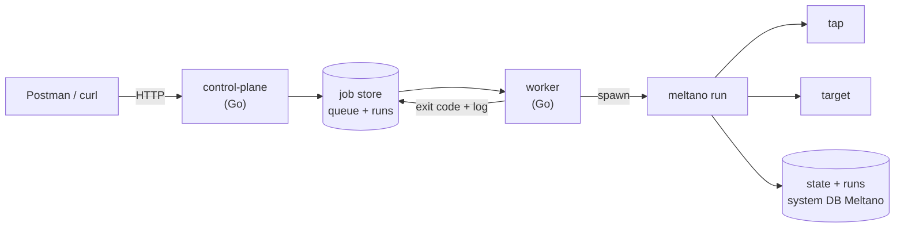

> Bagian 16 dari 16 - [Daftar Isi](README.md)

# 16. Cara Menjalankan Meltano + Control Plane Golang

Runbook end-to-end: dari nol sampai satu pipeline berjalan lewat API, dengan Meltano sebagai execution engine
dan control plane Golang sebagai otak.

Seluruh langkah di bagian 16.2 sampai 16.6 sudah **diuji dan berhasil** pada Windows dengan Git Bash
(Go 1.26.8, Meltano 4.4.1, Python 3.13.15). Lihat bukti di 16.8.

---

## 16.1 Dua Proses yang Terlibat



Yang perlu dipahami: **control plane tidak menyentuh data**. Ia menyiapkan job, menjalankan Meltano,
lalu membaca hasilnya. Semua pemindahan data terjadi di dalam proses tap dan target milik Meltano.

---

## 16.2 Prasyarat

| Kebutuhan | Versi teruji | Catatan |
|---|---|---|
| Go | 1.26.8 | minimum 1.24 |
| Meltano | 4.4.1 | dipasang dari checkout, lihat doc 15 bagian 15.2 |
| Python | 3.13.15 | untuk menjalankan Meltano |
| Postman | opsional | atau `curl` |

Pastikan tiga hal ini bekerja sebelum lanjut:

```bash
# 1. Meltano dari checkout, bukan PyPI
source /c/Users/User/Documents/devel/meltano/.venv/Scripts/activate
meltano --version          # -> meltano, version 4.4.1

# 2. Control plane bisa dibuild
cd /c/Users/User/Documents/devel/meltano/controlplane
go build ./...             # -> tanpa output = sukses

# 3. Uji unit lolos
go test ./internal/meltano/
```

Di Windows, `PYTHONUTF8=1` wajib untuk Meltano (lihat doc 15 bagian 15.3). Control plane sudah
menyetelnya otomatis untuk setiap proses anak, jadi Anda tidak perlu mengulanginya di shell.

---

## 16.3 Langkah 1 - Siapkan Project Tenant

Control plane **tidak** membuat project Meltano. Itu tugas provisioning, sekali per tenant.

```bash
export PYTHONUTF8=1
cd /srv/tenants                       # atau direktori apa pun
meltano init acme --no-usage-stats
cd acme

meltano add extractor tap-gitlab      # ganti sesuai sumber data Anda
meltano add loader    target-jsonl    # ganti sesuai tujuan
meltano install                        # paling lama, butuh jaringan

meltano config set tap-gitlab start_date 2024-01-01
```

Catat dua hal dari project ini:

- **`default_environment: dev`** sudah dibuat otomatis oleh `init`. Ini yang membuat `meltano run` punya
  environment aktif, dan environment adalah komponen pertama `state_id`.
- **Direktori project** akan dipakai worker sebagai `cwd`. Worker mencarinya sebagai
  `<CP_TENANTS_ROOT>/<nama tenant>`.

Untuk contoh cepat tanpa database, `tap-gitlab` + `target-jsonl` adalah pilihan terbaik: proyek GitLab
publik `meltano/meltano` bisa dibaca tanpa kredensial.

---

## 16.4 Langkah 2 - Jalankan Control Plane

### Mode demo: worker tertanam

Mode ini menjalankan API dan worker di **satu proses** dengan store yang sama, sehingga alur
`POST /runs` → eksekusi → status terminal bisa dicoba tanpa Postgres.

```bash
cd /c/Users/User/Documents/devel/meltano/controlplane

export CP_HTTP_ADDR=127.0.0.1:8080
export CP_DATABASE_URL=postgres://placeholder          # belum dipakai di mode in-memory
export CP_EMBEDDED_WORKER=true
export CP_TENANTS_ROOT=/srv/tenants                    # direktori induk project tenant
export CP_MELTANO_BIN=/c/Users/User/Documents/devel/meltano/.venv/Scripts/meltano.exe
export CP_SECRET_DEMO=dummy                            # lihat catatan kredensial di 16.7
export CP_LOG_LEVEL=info

go run ./cmd/control-plane
```

Yang akan terlihat di log:

```json
{"level":"WARN","msg":"worker tertanam aktif (demo); produksi memakai store Postgres + cmd/worker"}
{"level":"INFO","msg":"control plane mendengarkan","addr":"127.0.0.1:8080"}
{"level":"INFO","msg":"worker mulai","worker_id":"...-embedded","lease":300000000000,"heartbeat":10000000000}
```

### Mode produksi (belum siap)

Mode produksi memerlukan **store Postgres bersama**, yang belum diimplementasikan. Lihat 16.7.

---

## 16.5 Langkah 3 - Import Postman

Collection-nya sudah disiapkan dan bisa langsung diimpor:

```
controlplane/postman/control-plane.postman_collection.json
```

Cara impor:

1. Postman -> **Import** -> **Files** -> pilih file JSON di atas.
2. Collection **"Replication Control Plane (Go + Meltano)"** akan muncul dengan 6 folder dan 20 request.
3. Buka **Variables** pada collection, sesuaikan bila perlu:

| Variable | Default | Ganti bila |
|---|---|---|
| `baseUrl` | `http://localhost:8080` | port control plane berbeda |
| `tenantName` | `acme` | nama tenant Anda |
| `environmentName` | `acme` | harus sama dengan environment di project Meltano |
| `extractorName` | `tap-postgres` | memakai `tap-gitlab` untuk demo |
| `loaderName` | `target-postgres` | memakai `target-jsonl` untuk demo |

4. Jalankan folder **berurutan dari atas ke bawah**, atau pakai **Collection Runner** (Run collection).

ID otomatis tersimpan ke variable: `tenantId`, `sourceConnectionId`, `destinationConnectionId`,
`pipelineId`, `runId`. Anda tidak perlu menyalin ID manual.

`Idempotency-Key` dibuat otomatis untuk setiap request oleh pre-request script di level collection.

### Urutan folder

| Folder | Isi | Efek |
|---|---|---|
| `0 - Meta` | health, ready, version | verifikasi server hidup dan versi Meltano terbaca |
| `1 - Tenant` | create, list | membuat tenant, menyimpan `tenantId` |
| `2 - Connections` | create source, create destination, list | menyimpan dua connection id |
| `3 - Pipeline` | create, validate, get, list | menyimpan `pipelineId`; validate menampilkan `resolved_state_id` |
| `4 - Run` | start, get, list, events, dan uji 409 | menyimpan `runId`; request terakhir membuktikan pengaman run ganda |
| `5 - Cancel & Retry` | cancel, retry, state | menguji pembatalan lalu menjadwalkan ulang |

### Kalau memakai curl

```bash
B=http://localhost:8080

curl -sX POST $B/v1/tenants -H 'Content-Type: application/json' \
  -d '{"name":"acme","environment_name":"dev"}'

curl -sX POST $B/v1/connections -H 'Content-Type: application/json' \
  -d '{"tenant_id":"<tenantId>","name":"gl","kind":"source","driver":"postgres",
       "endpoint":{"host":"x"},"secret_ref":"demo"}'
# ... ulangi untuk destination ...

curl -sX POST $B/v1/pipelines -H 'Content-Type: application/json' \
  -d '{"tenant_id":"<tenantId>","name":"gl-sync",
       "extractor":"tap-gitlab","loader":"target-jsonl",
       "source_connection_id":"<sourceConn>","destination_connection_id":"<destConn>",
       "default_timeout_seconds":300,"max_attempts":1}'

curl -sX POST $B/v1/pipelines/<pipelineId>/runs \
  -H 'Idempotency-Key: <uuid>' -H 'Content-Type: application/json' \
  -d '{"timeout_seconds":300}'

curl -s $B/v1/runs/<runId>
```

---

## 16.6 Langkah 4 - Verifikasi Hasil

### Dari sisi control plane

```bash
curl -s $B/v1/runs/<runId>
```

Nilai yang diharapkan setelah selesai:

```json
{
  "id": "...",
  "status": "succeeded",
  "exit_code": 0,
  "error": "",
  "started_at": "...",
  "ended_at": "..."
}
```

Event-nya:

```bash
curl -s $B/v1/runs/<runId>/events
# data[].payload.phase -> "running", lalu "succeeded"
```

### Dari sisi Meltano

Worker meneruskan `run_id` control plane ke Meltano lewat dua jalur, sehingga korelasinya bisa dibuktikan
dari dua sisi:

```bash
cd /srv/tenants/acme
export PYTHONUTF8=1

# --run-id mengisi kolom runs.run_id
meltano logs list --format json | grep <runId>

# MELTANO_JOB_TRIGGER mengisi kolom runs.trigger
meltano --environment=dev state get dev:tap-gitlab-to-target-jsonl
```

Dan langsung ke system database Meltano:

```bash
python -c "
import sqlite3
c = sqlite3.connect('.meltano/meltano.db')
for row in c.execute('select job_name, state, run_id, trigger from runs order by id desc limit 5'):
    print(row)
"
```

Nilai yang diharapkan: kolom `trigger` berisi **UUID run dari control plane**, bukan `"cli"`.

---

## 16.7 Mode Produksi - Yang Masih Kurang

Runbook di atas memakai worker tertanam dengan store in-memory. Untuk produksi, tiga hal ini wajib
diselesaikan lebih dulu:

| Kekurangan | Akibat sekarang | Yang dibutuhkan |
|---|---|---|
| Store in-memory | API dan worker **tidak berbagi data**; hanya bisa satu proses | implementasi `store.Store` dengan Postgres |
| Resolver secret | `EnvResolver` membaca env var proses worker | Vault / AWS Secrets Manager, resolusi saat spawn |
| Autentikasi | `tenant_id` dikirim di body/query | token + scope, lihat doc 14 bagian 14.1.2 |

Selama store masih in-memory, **jangan menjalankan `cmd/worker` terpisah dari `cmd/control-plane`** — keduanya
akan punya datanya sendiri dan tidak akan pernah bertemu.

---

## 16.8 Bukti Uji End-to-End

Uji dijalankan pada Windows: control plane Go men-spawn Meltano sungguhan lewat `Adapter.Run`.

**Hasil:**

```
status     : succeeded
exit_code  : 0
durasi     : 5,24 detik
```

**argv yang benar-benar dieksekusi** (dari log control plane):

```
meltano.exe --environment=dev --log-format=json run tap-gitlab target-jsonl \
  --run-id=<uuid> --timeout=300 --no-install
```

**Korelasi terbukti dari system database Meltano:**

| Kolom | Nilai |
|---|---|
| `runs.run_id` | UUID yang dikirim sebagai `--run-id` |
| `runs.trigger` | UUID yang dikirim sebagai `MELTANO_JOB_TRIGGER` (bukan `"cli"`) |
| `runs.job_name` | `dev:tap-gitlab-to-target-jsonl` |

**Dua bug nyata ditemukan oleh uji ini dan sudah diperbaiki:**

1. **Deadlock heartbeat.** Worker menunggu channel heartbeat ditutup, padahal goroutine heartbeat baru
   berhenti setelah `cancel` dipanggil - dan `cancel` baru berjalan saat fungsi itu selesai. Akibatnya run
   selesai di Meltano tetapi status di control plane macet di `running` selamanya. Perbaikan:
   `stopHB()` dipanggil sebelum menunggu (`internal/worker/worker.go`).

2. **`MELTANO_FF_STRICT_ENV_VAR_MODE=1` mematahkan plugin nyata.** Rekomendasi awal di doc 15 ternyata
   salah. Dengan mode itu, setiap run gagal dalam ~4 detik:

   ```
   Cannot start plugin tap-gitlab: Environment variable 'TITLEPREFIX' referenced but not set.
   ```

   Penyebabnya: definisi plugin memuat nilai default yang mereferensikan env var milik paketnya sendiri.
   Setelah variabel itu dihapus dari environment adapter, run yang sama berhasil dengan exit code 0.
   Adapter sekarang **tidak** menyetelnya secara default (`internal/meltano/adapter.go`).

---

## 16.9 Troubleshooting

| Gejala | Sebab | Solusi |
|---|---|---|
| Status macet di `running` | heartbeat/deadlock (sudah diperbaiki) atau worker mati | cek log control plane; reconciler akan menandai `failed` setelah lease habis |
| `409 Conflict` saat start run | pipeline sudah punya run aktif | tunggu, batalkan, atau retry setelahnya |
| `unprocessable: state_id_suffix tidak boleh mengandung ':'` | suffix berisi `:` | ganti suffix |
| `resolver secret belum dikonfigurasi` | mode worker terpisah memakai `DenyAllResolver` | pakai `CP_EMBEDDED_WORKER=true`, atau pasang resolver nyata |
| `secret "..." tidak ditemukan; set CP_SECRET_...` | `EnvResolver` tidak menemukan env var | set `CP_SECRET_<REF>` dengan ref dinormalkan (non-alfanumerik jadi `_`, uppercase) |
| Meltano exit 1 dengan `Cannot start plugin ... referenced but not set` | strict env var mode | pastikan `MELTANO_FF_STRICT_ENV_VAR_MODE` tidak diset |
| Worker tidak menemukan project | `CP_TENANTS_ROOT` atau nama tenant tidak cocok | worker mencari `<CP_TENANTS_ROOT>/<tenant.Name>` |
| `go build` gagal `Access is denied` pada cache | sandbox membatasi `%LOCALAPPDATA%\go-build` | `export GOCACHE="$TEMP/gocache-cp"` |

---

## 16.10 Ringkasan Perintah

```bash
# --- sekali per tenant ---
export PYTHONUTF8=1
meltano init acme --no-usage-stats && cd acme
meltano add extractor tap-gitlab && meltano add loader target-jsonl
meltano install
meltano config set tap-gitlab start_date 2024-01-01

# --- setiap kali menjalankan control plane ---
cd .../controlplane
export CP_EMBEDDED_WORKER=true CP_TENANTS_ROOT=/srv/tenants
export CP_MELTANO_BIN=/c/.../.venv/Scripts/meltano.exe
export CP_DATABASE_URL=postgres://placeholder CP_SECRET_DEMO=dummy
go run ./cmd/control-plane

# --- lalu di Postman ---
# Import control-plane.postman_collection.json
# Runner: jalankan folder 0 -> 5 berurutan
```

---

*Dokumen ini bagian 16 dari analisis Meltano v4.4.1 (commit `74725f257`). Bagian 15.2-15.6 dan 16.2-16.8
telah diuji langsung pada Windows dengan Git Bash.*

---

**Navigasi:** [Bagian 15: Menjalankan Meltano](15-menjalankan-meltano.md) - [Daftar Isi](README.md)
